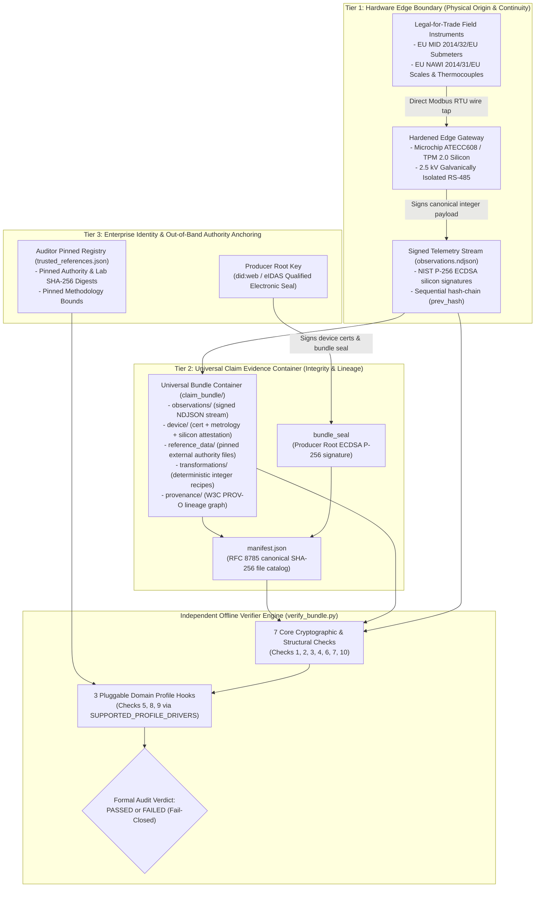

# Universal Claim Evidence Bundle Specification (v1.2)

> **Zero-Trust Cryptographic Container, Pluggable Profile Contract & 10-Check Verifier State Machine for Industrial IoT Telemetry**

---

## 1. Universal Engine Scope & Threat Model

The **Claim Evidence Bundle** is a self-contained, offline-verifiable cryptographic container that enables an independent auditor, conformity assessment body (CAB/VVB), or regulator to verify physical compliance claims directly from origin edge telemetry—with **zero trust** in the reporting operator, their cloud databases, or third-party SaaS platforms.

### 1.1 The Physical-to-Digital Boundary Problem
Across regulated industrial domains—whether energy submetering, green hydrogen production, industrial heat recovery, water treatment, or carbon dioxide removal—the root vulnerability is identical: **the facility operator has physical and administrative root access to the edge environment**. Traditional telemetry pipelines assume the operator is honest and focus only on TLS encryption in transit.

The Universal Claim Evidence Bundle Engine defends against both threat models simultaneously:
1. **Outsider Tampering (`O1–O11`):** Network packet interception, payload modification, unmanifested file injection, path traversal, or signature forgery by unauthorized third parties.
2. **Insider Operator Fraud (`I1–I5` & Domain Stress Vectors `B1–B17`):**
   * **Stream Truncation & Cherry-Picking:** Deleting anomalous, out-of-spec, or high-emission intervals/batches from the head, middle, or tail of a reporting window.
   * **Uncertified Sensor or Simulator Substitution:** Signing synthetic telemetry using software keys (`SOFTWARE_SIMULATOR_STUB`) or uncalibrated/expired sensors outside legal metrology windows.
   * **Reference Data Manipulation:** Swapping or cherry-picking unaccredited laboratory assays, emission factors, or feedstock delivery manifests post-hoc.
   * **Physical Boundary Gaming:** Violating conservation of energy or mass (e.g., water-weight inflation, exceeding delivered input caps, or double-counting overlapping claim windows across audits).

### 1.2 The "Engine vs. Car" Pluggable Architecture
This specification separates the **Universal Verification Engine** (the domain-agnostic cryptographic and structural state machine) from **Pluggable Domain Profile Drivers** (which encode the specific legal metrology standard, physical conservation law, and reference authority for a given industrial sector):

* **The Core Engine (7 Universal Checks):** Enforces RFC 8785 canonical JSON, manifest sealing, hardware secure-element attestation (`ATECC608B` / `TPM 2.0`), calibration time-window enforcement, ECDSA P-256 observation signatures, unbroken `prev_hash` hash-chains, W3C PROV-O lineage graphs, cross-claim double-counting prevention, and zero-tolerance integer reconciliation.
* **The Pluggable Profile Contract (3 Domain Hooks):** Any industrial vertical plugs into the engine by defining three declarative rules:
  1. **Check 5 Hook (Process Continuity Invariant):** Per-record physical state continuity (e.g., dual-register meter delta or minimum thermal threshold).
  2. **Check 8 Hook (Pinned Authority Registry):** Out-of-band SHA-256 digests of authoritative external inputs (e.g., national grid factors or ISO 17025 lab certificates).
  3. **Check 9 Hook (Physical Conservation & Recomputation):** Deterministic integer conservation inequalities and claim metric recomputation.

---

## 2. Universal Container Layout & Deterministic Canonicalization

### 2.1 Universal Bundle Directory Structure
Every Claim Evidence Bundle—regardless of industrial profile—conforms to the same self-contained directory layout:

```text
claim_bundle/
├── manifest.json                             # Canonical SHA-256 file catalog + Producer Root ECDSA Seal
├── claim.json                                # Declared claim metrics, profile ID, period/sequence bounds
├── observations/
│   └── observations.ndjson                   # Hardware-signed, hash-chained edge telemetry records
├── device/
│   ├── identity.json                         # Gateway, sensor bus, and physical asset identifiers
│   ├── public_key.pem                        # Edge gateway NIST P-256 public key
│   ├── device_certificate.json               # Root-signed certificate with legal metrology metadata
│   └── hardware_attestation.json             # Secure element (ATECC608 / TPM 2.0) silicon attestation
├── reference_data/
│   └── *.json | *.csv                        # Pinned external authority datasets (lab assays, grid factors)
├── transformations/
│   └── *.json                                # Declarative integer conservation & recomputation recipes
├── provenance/
│   └── provenance.json                       # W3C PROV-O cryptographic lineage graph
└── checksums.txt                             # Standard POSIX sha256sum catalog
```

### 2.2 Three-Tier Universal Cryptographic Architecture



### 2.3 Deterministic Canonicalization & Integer Arithmetic
To guarantee bit-for-bit reproducible verification across heterogeneous architectures and runtimes (Python, Rust, C/C++, Go) without IEEE 754 floating-point drift:

1. **RFC 8785 / JCS Canonical JSON:** All signed JSON payloads use compact separators (`,`, `:`), lexicographically sorted UTF-8 keys, and zero trailing whitespace.
2. **Duplicate Key Rejection:** The parser enforces a strict `object_pairs_hook` that immediately aborts (`FAIL-CLOSED`) if any JSON object contains duplicate keys, preventing parser-differential shadowing attacks.
3. **Strict Integer Base Units:** All physical telemetry and ratios inside conservation checks use scaled integers:
   * **Electrical Energy:** Integer Watt-hours ($\text{Wh}$).
   * **Mass:** Integer grams ($\text{g}$), where $1\text{ metric tonne} = 1{,}000{,}000\text{ g}$.
   * **Temperature:** Integer degrees Celsius ($^\circ\text{C}$).
   * **Dimensionless Ratios & Factors:** Integer basis points ($\text{bps}$), where $10{,}000\text{ bps} = 100.00\%$ and $1\text{ bps} = 0.01\%$.
4. **Path Traversal & Key Hygiene:** All manifest file paths are resolved and verified to remain strictly inside the bundle root directory. Any bundle containing private key material (`*private*`, `*.key`, `PKCS#8` private headers) or unmanifested files is rejected immediately.

### 2.4 Universal Observation Envelope & Sequential Hash-Chain
Every record in `observations/observations.ndjson` wraps a domain-specific `payload` object inside a universal cryptographic envelope:

```json
{
  "device_id": "device_edge_gateway_01",
  "sequence": 1,
  "prev_hash": "0000000000000000000000000000000000000000000000000000000000000000",
  "payload": {
    "sequence": 1,
    "...": "domain-specific integer telemetry fields"
  },
  "signature": "3045022100e4...",
  "algorithm": "ECDSA_P256_SHA256"
}
```

* **Genesis Anchor:** Record `sequence == 1` must bind `prev_hash` to 64 ASCII zeros (`"0" * 64`).
* **Sequential Chaining:** For every subsequent record $i > 1$, `prev_hash[i] == SHA-256(canonical_json(record[i-1]))`, where the hash covers the entire preceding envelope (including its `signature`).
* **Signature Scope:** The hardware secure element signs `SHA-256(canonical_json(signing_view))`, covering `device_id`, `sequence`, `prev_hash`, and `payload`.

---

## 3. Universal 10-Check Verifier State Machine & Pluggable Profile Contract

The reference verifier (`src/verifier/verify_bundle.py`) executes a deterministic, fail-closed 10-check state machine. Seven checks are **Universal Core Engine Checks**, and three checks are **Pluggable Profile Invariant Hooks** dispatched via `SUPPORTED_PROFILE_DRIVERS`.

### 3.1 The 7 Universal Core Engine Checks (Domain-Agnostic)
* **Check 1 — Manifest Integrity, Bundle Seal & Hygiene:** Verifies the Producer Root ECDSA P-256 signature on `manifest.json`, recomputes SHA-256 digests for every listed file, enforces bidirectional set equality between filesystem files and manifest entries (rejecting unmanifested files), blocks path traversal, and rejects any bundled private keys.
* **Check 2 — Device Certificate, Key Binding, Silicon Attestation & Metrology Window:** Verifies the Producer Root signature on `device/device_certificate.json`, confirms `device/public_key.pem` matches the certified public key, re-derives `device_id` from the public key fingerprint, validates the `ATECC608B` / `TPM 2.0` hardware attestation signature and `attested_public_key_sha256` binding (rejecting `SOFTWARE_SIMULATOR_STUB` when `--require-hardware-attestation` is enabled), and checks certificate validity (`valid_from < valid_until`) and legal metrology standard registration.
* **Check 3 — Observation Signatures & Dynamic Calibration Window:** Verifies the NIST P-256 ECDSA signature on every observation record against the certified device public key and confirms every observation timestamp falls strictly inside both the certificate validity window and the physical instrument's legal calibration window (`timestamp <= calibration_valid_until`).
* **Check 4 — Sequential Hash-Chain Continuity:** Recomputes the SHA-256 chain from the genesis zero-hash (`sequence == 1`) through the final record, asserting strictly incrementing sequence numbers (`+1`), unique record/batch identifiers, monotonic timestamps, and unbroken `prev_hash` links.
* **Check 6 — Claim Boundary Binding & Cross-Claim Replay Protection:** Confirms that the observation stream's `first_sequence`, `last_sequence`, record count, time bounds, and `terminal_hash` match `claim.json`. When `--claim-ledger <ledger.json>` is provided, enforces offline cross-claim deduplication so no `claim_id`, `terminal_hash`, `batch_id`, or `(device_id, sequence)` tuple can ever be double-counted across separate submissions.
* **Check 7 — W3C PROV-O Transformation Lineage:** Verifies `provenance/provenance.json` entity digests and confirms all transformation recipes in `transformations/` are cryptographically bound to the input observations and reference datasets.
* **Check 10 — Zero-Tolerance Numeric Reconciliation & Verdict:** Compares the engine's independently recomputed metrics (from Check 9) against the declared values in `claim.json` with zero tolerance, emitting a structured human or JSON audit verdict.

### 3.2 The 3 Pluggable Domain Profile Hooks
To add a new industrial vertical (e.g., `green_hydrogen_electrolysis`, `district_heating_mid`, or `water_discharge_monitoring`), a developer registers a profile entry in `SUPPORTED_PROFILE_DRIVERS` implementing three hooks:

1. **Check 5 Hook (`check5_hook` — Process Continuity Invariant):** Inspects sequential observation payloads to verify that the physical process remained within legal operating bounds across every interval or batch (e.g., no meter counter resets, no reactor flame-outs).
2. **Check 8 Hook (`check8_hook` — Authoritative Reference Data Verification):** Verifies SHA-256 digests and accreditation metadata of external reference files in `reference_data/` against the auditor's out-of-band pinned registry (`trusted_references.json`), preventing self-attested or substituted reference constants.
3. **Check 9 Hook (`check9_hook` — Physical Conservation & Deterministic Recomputation):** Evaluates domain conservation inequalities (mass balance, energy balance, yield caps, delivery caps) using integer arithmetic and independently recomputes the final regulatory claim metric.

### 3.3 Complete 10-Check Dispatch Matrix

| Check # | Engine Layer | Verification Stage | Core Engine / Reference Driver 1 (`energy_submetering`) | Reference Driver 2 (`biochar_pyrolysis`) |
|:---:|:---:|---|---|---|
| **1** | **Core Engine** | **Manifest & Bundle Seal** | Verifies Root ECDSA seal on `manifest.json`, SHA-256 of all files, no unmanifested files, no path traversal, no private keys. | Identical Core Engine enforcement. |
| **2** | **Core Engine** | **Device Cert, Silicon & Metrology** | Verifies Root cert signature, public key binding, `ATECC608B` attestation, and `EU_MID_2014_32_EU` (Class A/B/C) calibration window. | Verifies Root cert signature, public key binding, `ATECC608B` attestation, and `EU_Directive_2014_31_EU_NAWI` (Class I/II/III) + thermocouple window. |
| **3** | **Core Engine** | **Observation Signatures & Window** | Verifies P-256 signature on each reading; checks `timestamp` within cert and MID meter `calibration_valid_until`. | Verifies P-256 signature on each batch; checks `timestamp_end` within cert, NAWI scale, and thermocouple `calibration_valid_until`. |
| **4** | **Core Engine** | **Hash-Chain Continuity** | Verifies genesis `00..00`, `prev_hash` SHA-256 chain, sequence `+1`, monotonic timestamps. | Identical Core Engine enforcement + unique `batch_id` sequence enforcement. |
| **5** | **Profile Hook** | **Process Continuity Invariant** | Enforces dual-register meter invariant: `Δ cumulative_wh == interval_wh` across all intervals. | Enforces continuous thermal permanence threshold: $T_{\min} \ge 500^\circ\text{C}$ across all batches. |
| **6** | **Core Engine** | **Claim Boundary & Replay Ledger** | Binds `first_sequence`, `last_sequence`, `record_count`, `terminal_hash`, and checks `--claim-ledger` for `(device_id, seq)` replay. | Binds `first_sequence`, `last_sequence`, `batch_count`, `terminal_hash`, and checks `--claim-ledger` for `batch_id` / `terminal_hash` replay. |
| **7** | **Core Engine** | **W3C PROV-O Lineage** | Validates `provenance.json` entity SHA-256 digests and transformation recipe bindings. | Identical Core Engine enforcement. |
| **8** | **Profile Hook** | **Pinned Authority Reference** | Verifies `grid_emission_factors.csv` SHA-256 digest and row factors against pinned `trusted_references.json`. | Verifies ISO 17025 `lab_analysis.json` and `feedstock_manifest.json` SHA-256 digests + statutory bounds ($H/C_{\text{org}} \le 0.70$, $^{14}\text{C} \ge 95\%$, heavy metals pass). |
| **9** | **Profile Hook** | **Conservation & Recomputation** | Recomputes sum of integer `interval_wh` and calculates Scope 2 $\text{kg CO}_2\text{e}$ via pinned factor. | Enforces 6-part mass-balance conservation ($M_{\text{dry},i} \le M_{\text{feed},i}$, dry yield $\le 40\%$, delivery cap, lab batch binding) & recomputes net $\text{t CO}_2$. |
| **10** | **Core Engine** | **Zero-Tolerance Reconciliation** | Asserts exact match between recomputed and declared `total_wh`, `total_kwh`, and `co2e_kg`. | Asserts exact match between recomputed and declared `total_wet_mass_g`, `total_dry_mass_g`, and `net_tonnes_co2_removed`. |

---

## 4. Reference Driver 1: `energy_submetering` (Continuous Linear Flow)

This reference driver validates the engine against **continuous linear cumulative telemetry** (electrical submetering under EU Measuring Instruments Directive 2014/32/EU and CSRD Scope 2 accounting).

### 4.1 Observation Payload Schema (`observations/observations.ndjson`)
```json
{
  "timestamp": 1772323200,
  "interval_seconds": 3600,
  "cumulative_wh": 1001250,
  "interval_wh": 1250,
  "sequence": 1
}
```

### 4.2 Metrology & Profile Invariant Hooks (Checks 5, 8, 9)
1. **Legal Metrology Binding (Check 2/3):** `device_certificate.json` binds an `EU_MID_2014_32_EU` (`Class_B`, `EN_50470_3`) legal-for-trade submeter with `calibration_valid_until`.
2. **Check 5 Hook (Dual-Register Continuity):** Every interval $i > 1$ must satisfy exact register conservation between the non-resettable totalizer ($E_{\text{cum}}$) and the interval register ($E_{\text{int}}$), i.e., `cumulative_wh[i] - cumulative_wh[i-1] == interval_wh[i]`:
   $$E_{\text{cum}}[i] - E_{\text{cum}}[i-1] = E_{\text{int}}[i]$$
3. **Check 8 Hook (Pinned Authority Reference):** Verifies `reference_data/grid_emission_factors.csv` against the auditor's pinned SHA-256 digest in `trusted_references.json` (`0.254 kg CO2e/kWh`, ISPRA / EEA).
4. **Check 9 Hook (Recomputation):**
   $$\text{Total kWh} = \frac{\sum E_{\text{int}}}{1000}, \quad \text{Total kg CO}_2\text{e} = \text{Total kWh} \times F_{\text{grid}}$$

---

## 5. Reference Driver 2: `biochar_pyrolysis` (Non-Linear Mass & Thermal Transformation)

This reference driver stress-tests the engine against **non-linear multi-sensor physical transformations** where raw input mass undergoes thermal conversion, moisture loss, and chemical assay verification (governed by EU Directive 2014/31/EU NAWI scales and EU Carbon Removals and Carbon Farming Regulation (EU) 2024/3012 / Delegated Regulation (EU) 2026/285).

### 5.1 Observation Payload Schema (`observations/observations.ndjson`)
```json
{
  "timestamp_start": 1790800000,
  "timestamp_end": 1790814400,
  "feedstock_input_g": 6250000,
  "feedstock_delivery_ref": "delivery_fsc_wood_2026_09",
  "scale_wet_mass_g": 2000000,
  "temp_min_c": 585,
  "temp_avg_c": 625,
  "temp_max_c": 642,
  "scale_id": "scale_floor_indicator_01",
  "sequence": 1
}
```

### 5.2 Metrology & Profile Invariant Hooks (Checks 5, 8, 9)
1. **Legal Metrology Binding (Check 2/3):** `device_certificate.json` binds both a legal-for-trade weighing instrument (`EU_Directive_2014_31_EU_NAWI`, `Class_III`, `max_capacity_g`, `calibration_valid_until`) and a calibrated reactor thermocouple module (`Type_K_Thermocouple`, `calibration_valid_until`).
2. **Check 5 Hook (Thermal Permanence Continuity):** Every batch must maintain continuous pyrolysis temperature at or above the statutory permanence threshold pinned in `trusted_references.json`:
   $$T_{\min} \ge 500^\circ\text{C}$$
3. **Check 8 Hook (Pinned ISO 17025 Lab & Delivery Registry):** Verifies SHA-256 digests of `reference_data/lab_analysis.json` (`ISO_17025`) and `reference_data/feedstock_manifest.json` against `trusted_references.json`, and enforces statutory chemical bounds:
   * Molar ratio $H/C_{\text{org}} \le 0.70$ (`max_h_c_org_ratio`).
   * Radiocarbon biogenic fraction $^{14}\text{C} \ge 9500\text{ bps}$ ($95.00\%$, rejecting fossil coal adulteration).
   * ICP-MS toxic heavy-metal screening (`heavy_metals_pass == true`).
4. **Check 9 Hook (6-Part Mass-Balance Conservation & Stoichiometric Recomputation):**
   * **Moisture Discount (Integer Basis Points):** `M_dry_g = M_wet_g * (10000 - moisture_bps) // 10000`.
   * **Per-Batch & Aggregate Mass Conservation:** $M_{\text{dry}, i} \le M_{\text{feedstock}, i}$ and $\sum M_{\text{dry}} \le \sum M_{\text{feedstock}}$.
   * **Thermodynamic Dry Yield Ceiling:** Per-batch dry yield cannot exceed the pinned physical wood pyrolysis ceiling (`biochar_max_dry_yield_bps = 4000`, i.e., $40.00\%$): `M_dry_i * 10000 <= M_feedstock_i * 4000`.
   * **Delivered Biomass Cap:** $\sum M_{\text{feedstock}} \le M_{\text{delivered}}$ from `feedstock_manifest.json`.
   * **Batch-to-Lab & Delivery Reference Binding:** Every batch must belong to `sample_batch_ref` and match `feedstock_delivery_ref`.
   * **Stoichiometric Net Removal:**
     $$\text{Gross CO}_2\text{ (g)} = M_{\text{dry}} \times C_{\text{org}} \times F_{\text{perm}} \times \frac{44}{12}, \quad \text{Net CO}_2\text{ (g)} = \text{Gross CO}_2\text{ (g)} - E_{\text{process}}$$

---

## 6. Universal Audit Verdict Terminology

When `verify_bundle.py` completes all 10 checks, it outputs a deterministic audit verdict mapping to four universal assurance properties:

* **"Declared origin verified"** (Checks 1–3): Hardware secure-element attestation, legal metrology calibration windows, and per-observation ECDSA P-256 signatures are cryptographically valid.
* **"Stream & process continuity verified"** (Checks 4–6): The observation hash-chain is unbroken from genesis to terminal hash, process continuity invariants hold for every record, and no records overlap prior claims in the deduplication ledger.
* **"Physical conservation & reference authority verified"** (Checks 7–9): W3C PROV-O lineage is intact, external reference datasets match out-of-band pinned SHA-256 digests, and all domain conservation inequalities hold.
* **"Calculation lineage verified"** (Check 10): Independent integer recomputation from raw signed observations matches the declared claim metrics with zero tolerance.
