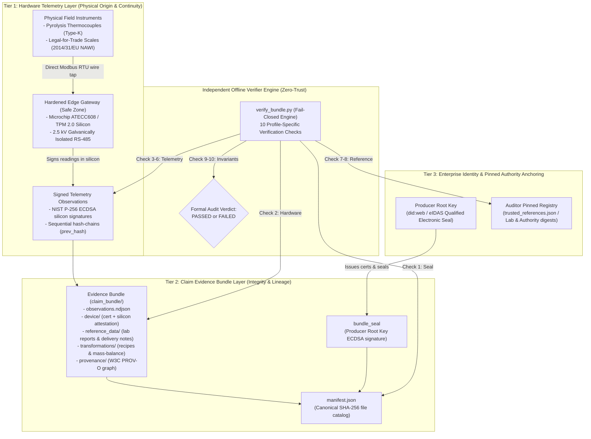

# Claim Evidence Bundle Specification (v1.2)

> **Zero-Trust Cryptographic Evidence Protocol for High-Durability Carbon Removals and Industrial Telemetry**

---

## 1. Design Goal & Zero-Trust Scope

The Claim Evidence Bundle enables an independent auditor, certification body (VVB), or regulator to verify declared sustainability claims and recompute carbon metrics directly from origin physical telemetry with **zero trust** in the reporting enterprise, its cloud infrastructure, or third-party SaaS platforms.

The protocol defends against both:
1. **Outsider Tampering:** Third-party packet interception, transmission alteration, data tampering, or payload forgery.
2. **Insider Fraud & Greenwashing:** 
   * Deletion of cold-burn or anomalous batches (period head/tail truncation).
   * Artificial mass inflation (e.g., spraying biochar with water prior to weighing).
   * Cherry-picking uncertified laboratory carbon ratios ($C_{\text{org}}$) or post-hoc lab substitution.
   * Uncertified software simulator key injection.
   * Post-hoc spreadsheet alterations or database updates.

The specification defines a **modular, multi-profile architecture**:
* **Primary Profile (`biochar_pyrolysis`):** High-durability Carbon Dioxide Removal (CDR) dMRV under EU CRCF (Delegated Regulation (EU) 2026/285), Puro.earth, and European Biochar Certificate (EBC) standards.
* **Secondary Profile (`energy_submetering`):** Industrial electrical energy submetering and Scope 2 GHG accounting under EU CSRD and EPBD.

---

## 2. Three-Tier Cryptographic Architecture



---

## 3. Primary Profile: High-Durability Carbon Removal (`biochar_pyrolysis`)

### 3.1 Bundle Directory Structure

```text
claim_bundle/
├── manifest.json                             # Canonical SHA-256 file catalog + Producer Bundle Seal
├── claim.json                                # Declared removal metrics, profile ID, batch bounds
├── observations/
│   └── observations.ndjson                   # Signed batch records (temperatures, masses, timestamps)
├── device/
│   ├── identity.json                         # Gateway, kiln, thermocouple, and scale IDs
│   ├── public_key.pem                        # Gateway NIST P-256 public key
│   ├── device_certificate.json               # Signed certificate with EU 2014/31/EU scale metrology
│   └── hardware_attestation.json             # Microchip ATECC608 factory CA attestation certificate
├── reference_data/
│   ├── lab_analysis.json                     # Accredited ISO 17025 lab report (C_org, moisture, H/C_org)
│   ├── lab_analysis_metadata.json            # Lab accreditation body, certificate SHA-256 digest
│   └── feedstock_manifest.json               # Delivery note digest, EBC positive list code, delivered mass
├── transformations/
│   ├── mass_balance.json                     # Recipe: moisture adjustment & physical invariant proofs
│   └── carbon_removal_calculation.json       # Recipe: EU CRCF / Puro net CO2 removal recomputation
├── provenance/
│   └── provenance.json                       # W3C PROV-O lineage graph
└── checksums.txt                             # Standard sha256sum catalog
```

### 3.2 Deterministic Standards & Integer Units
To eliminate floating-point non-determinism across platforms and runtimes (Python, Rust, C), all physical and laboratory values are recorded strictly as **integers**:

1. **Mass ($M$):** Integer grams ($\text{g}$).
   * Example: $2.500\text{ metric tonnes} = 2,500,000\text{ g}$.
2. **Temperature ($T$):** Integer degrees Celsius ($^\circ\text{C}$).
3. **Laboratory Ratios & Factors:** Integer basis points ($\text{bps}$), where $10,000\text{ bps} = 100.00\%$, and $1\text{ bps} = 0.01\%$.
   * Example: $81.25\%\text{ organic carbon} = 8125\text{ bps}$.
   * Example: $12.50\%\text{ moisture} = 1250\text{ bps}$.
   * Example: $80.00\%\text{ permanence factor} = 8000\text{ bps}$.
4. **Stoichiometric Ratio:** $44/12$ ($\text{CO}_2$ to $\text{C}$ molecular weight ratio).
5. **Deterministic Canonical JSON (RFC 8785 / JCS):** Compact separators (`,`, `:`), keys sorted lexicographically, UTF-8 encoded with no trailing whitespace.

### 3.3 Batch Observation Schema (`observations/observations.ndjson`)

Each row represents an indivisible production run signed at origin:

```json
{
  "device_id": "device_biochar_edge_01",
  "batch_id": "batch_2026_10_001",
  "sequence": 1,
  "prev_hash": "0000000000000000000000000000000000000000000000000000000000000000",
  "payload": {
    "timestamp_start": 1790800000,
    "timestamp_end": 1790814400,
    "feedstock_input_g": 6250000,
    "feedstock_delivery_ref": "delivery_fsc_wood_2026_09",
    "scale_wet_mass_g": 2000000,
    "temp_min_c": 585,
    "temp_avg_c": 625,
    "temp_max_c": 642,
    "scale_id": "scale_floor_indicator_01",
    "sequence": 1
  },
  "signature": "3045022100e4...",
  "algorithm": "ECDSA_P256_SHA256"
}
```

* **Sequential Hash-Chain:** `prev_hash[i]` = $\text{SHA-256}(\text{canonical\_json}(\text{record}[i-1]))$.
* **Genesis Hash:** Record 1 uses 64 zeros.

### 3.4 Physical & Mathematical Invariant Rules

The verifier enforces strict physical laws:

1. **Moisture Discount (Net Dry Mass):**
   $$M_{\text{dry\_g}} = \frac{M_{\text{wet\_g}} \times (10,000 - \text{moisture\_bps})}{10,000}$$
2. **Mass-Balance Upper Bound:** The dry mass of biochar produced can never exceed the dry biomass feedstock fed into the reactor:
   $$M_{\text{biochar, dry\_g}} \le M_{\text{feedstock\_g}}$$
3. **Feedstock Delivery Cap:** The cumulative feedstock used across verified batches cannot exceed the total verified biomass volume on the delivery manifest:
   $$\sum M_{\text{feedstock\_input\_g}} \le M_{\text{feedstock\_delivered\_total\_g}}$$
4. **Thermal Permanence Lower Bound:** Continuous minimum temperature across every batch must meet or exceed the statutory permanence threshold:
   $$T_{\min} \ge 500^\circ\text{C}$$
5. **Net Carbon Dioxide Removal ($\text{CO}_2$):**
   $$\text{Gross CO}_2\text{ (g)} = M_{\text{dry\_g}} \times \frac{C_{\text{org\_bps}}}{10,000} \times \frac{F_{\text{perm\_bps}}}{10,000} \times \frac{44}{12}$$
   $$\text{Net CO}_2\text{ (g)} = \text{Gross CO}_2 - E_{\text{process\_g}}$$
   $$\text{Net Tonnes CO}_2 = \frac{\text{Net CO}_2\text{ (g)}}{1,000,000}$$

### 3.5 Metrological Scale Pedigree (`device/device_certificate.json`)

To prevent cheap, drifting scale substitution, the Device Certificate cryptographically binds legal weighing metrology:

```json
{
  "certificate_body": {
    "device_id": "device_biochar_edge_01",
    "device_type": "pyrolysis_dMRV_gateway",
    "kiln_binding": "kiln_rotary_continuous_01",
    "metrology": {
      "scale_model": "Mettler Toledo IND570",
      "standard": "EU_Directive_2014_31_EU_NAWI",
      "accuracy_class": "Class_III",
      "max_capacity_g": 5000000,
      "scale_serial_number": "MT-IND570-984321",
      "calibration_cert_sha256": "4b92b67f...",
      "calibration_valid_until": 1893456000
    },
    "thermocouple_module": {
      "module_model": "Advantech ADAM-4015",
      "sensor_type": "Type_K_Thermocouple",
      "calibration_valid_until": 1893456000
    },
    "device_public_key": "-----BEGIN PUBLIC KEY-----\n...",
    "valid_from": 1767225600,
    "valid_until": 1830297600,
    "issued_by": "producer_authority_eu"
  },
  "company_signature": "30460221...",
  "algorithm": "ECDSA_P256_SHA256"
}
```

---

## 4. Secondary Profile: Industrial Energy Submetering (`energy_submetering`)

The secondary profile supports electrical energy telemetry and Scope 2 GHG accounting:
* **Metric Units:** Integer Watt-hours ($\text{Wh}$).
* **Dual-Register Invariant:** $\Delta \text{cumulative\_wh} == \text{interval\_wh}$.
* **Metrology:** EU Measuring Instruments Directive (MID 2014/32/EU Class B, EN 50470-3).
* **Reference Factor:** Pinned grid emission factors from authoritative databases (ISPRA / EEA).
* **Recomputation:** $\text{Total } \text{kg CO}_2\text{e} = (\text{Total Wh} / 1000) \times \text{Factor}$.

---

## 5. Ten-Check Verifier Standard (Universal Engine)

The offline verifier CLI (`verify_bundle.py`) operates fail-closed, automatically dispatching profile-specific checks based on `claim.json`:

| Check # | Universal Check Name | Biochar CDR Implementation | Energy Submetering Implementation |
|:---:|---|---|---|
| **1** | **Manifest & Bundle Seal** | Validates SHA-256 of all files. Verifies Producer Root signature on `manifest.json`. Rejects path traversal and unmanifested files. | Validates SHA-256 of all files. Verifies Company Root signature on `manifest.json`. Rejects path traversal and unmanifested files. |
| **2** | **Device Certificate & Metrology** | Verifies Producer Root signature on device cert. Validates ATECC608 silicon attestation. Asserts EU Directive 2014/31/EU Class III scale calibration is unexpired. | Verifies Company Root signature on device cert. Validates ATECC608 silicon attestation. Asserts EU MID 2014/32/EU Class B calibration is unexpired. |
| **3** | **Observation Signatures** | Verifies ECDSA P-256 signatures for every batch against certified device key. Checks timestamps fall within certificate window. | Verifies ECDSA P-256 signatures for every interval reading against certified device key. Checks timestamps within validity window. |
| **4** | **Hash-Chain Continuity** | Verifies unbroken sequential `prev_hash` across all batch records without head, middle, or tail truncation. | Verifies unbroken sequential `prev_hash` across all interval records without head, middle, or tail truncation. |
| **5** | **Physical Process Integrity** | Asserts all batches maintain continuous certified pyrolysis temperature ($T_{\min} \ge 500^\circ\text{C}$). Rejects kiln flame-outs. | Asserts strictly monotonic sequences and dual-register delta match ($\Delta \text{cumulative\_wh} == \text{interval\_wh}$). |
| **6** | **Claim Boundary Bounding** | Confirms batch observations match declared `first_sequence`, `last_sequence`, `batch_count`, and `terminal_hash`. | Confirms interval observations match declared `first_sequence`, `last_sequence`, `record_count`, and `terminal_hash`. |
| **7** | **Transformation Lineage** | Validates W3C PROV-O graph entity digests. Validates recipes in `transformations/`. | Validates W3C PROV-O graph entity digests. Validates recipes in `transformations/`. |
| **8** | **Authoritative Reference Data** | Validates ISO 17025 accredited laboratory report SHA-256 digest and feedstock delivery note digest against pinned registry. | Validates grid emission factor CSV digest against pinned registry (`trusted_references.json`). |
| **9** | **Physical Invariants & Recomputation** | Evaluates mass-balance invariants: (1) $M_{\text{dry}} \le M_{\text{feedstock}}$; (2) used $\le$ delivered; and recomputes net $\text{t CO}_2$ removed. | Recomputes aggregated integer Wh and calculates Scope 2 GHG using pinned emission factor. |
| **10** | **Numeric Reconciliation & Verdict** | Reconciles independently recomputed net carbon removals against declared claim with zero tolerance. Emits audit report. | Reconciles independently recomputed Scope 2 carbon against declared claim with zero tolerance. Emits audit report. |

---

## 6. Audit Verdict Terminology

* **"Declared origin verified"**: Physical sensor and gateway silicon origin cryptographically proven.
* **"Permanence conditions verified"**: Thermal and physical operating parameters verified within statutory limits.
* **"Mass-balance verified"**: Physical conservation laws validated from origin receipts to output biochar.
* **"Calculation lineage verified"**: Mathematical recalculation reproducible from certified raw inputs without floating-point drift.
