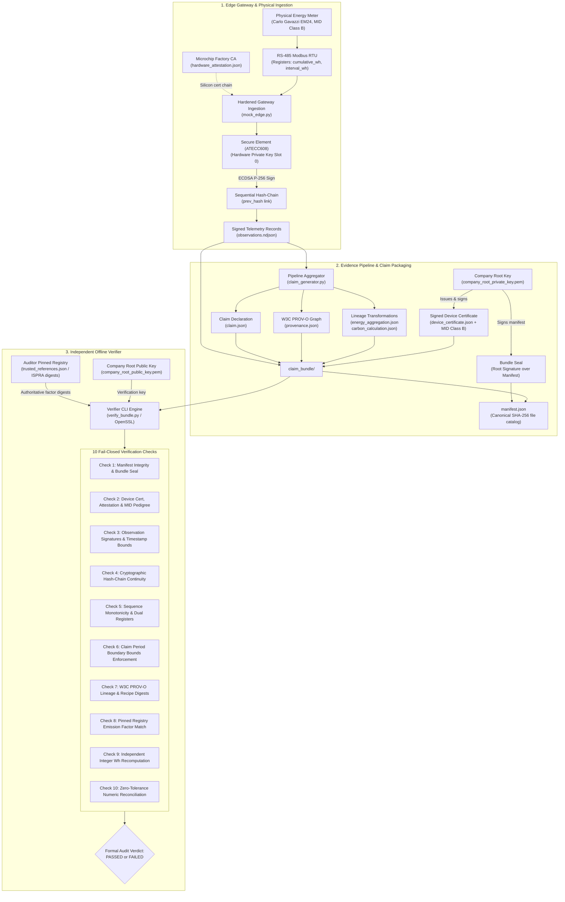
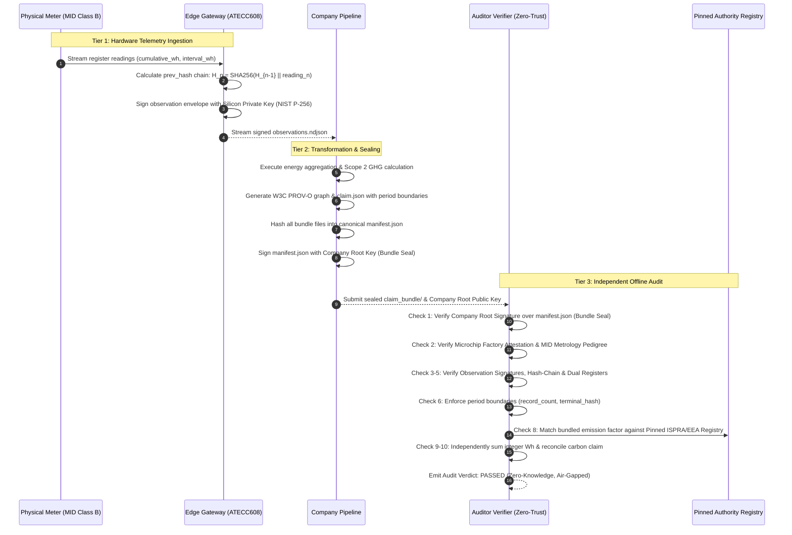

# System Architecture & Implementation (v1.1)

This directory documents the technical architecture, cryptographic data flow, and components of the **Verifiable Telemetry** pipeline.

---

## 1. System Architecture & Data Flow

---

## 2. Directory & Component Mapping

| Directory / File | Role | Description |
|---|---|---|
| [`src/device_simulator/mock_edge.py`](../src/device_simulator/mock_edge.py) | Edge Simulator | Simulates physical Modbus RTU registers, Microchip ATECC608 silicon attestation, sequential hash-chain calculation (`prev_hash`), and NIST P-256 observation signing. |
| [`src/pipeline/claim_generator.py`](../src/pipeline/claim_generator.py) | Claim Pipeline | Ingests observation streams, applies deterministic integer Wh summation and GHG Scope 2 calculations, builds W3C PROV-O provenance, generates `manifest.json`, and cryptographically seals the bundle. |
| [`src/verifier/verify_bundle.py`](../src/verifier/verify_bundle.py) | Offline Verifier | Independent zero-trust verification CLI executing 10 fail-closed checks using native OpenSSL. Zero pip dependencies. |
| [`src/verifier/trusted_references.json`](../src/verifier/trusted_references.json) | Pinned Registry | Pinned authoritative emission factor database hashes (ISPRA 2026, EEA) maintained independently by the auditor. |
| [`src/attacks/outsider_attacks.py`](../src/attacks/outsider_attacks.py) | Outsider Benchmark | Programmatic test harness verifying rejection of 10 outsider adversarial attack vectors. |
| [`src/attacks/insider_fraud_suite.py`](../src/attacks/insider_fraud_suite.py) | Insider Benchmark | Programmatic test harness verifying rejection of 5 insider fraud vectors (greenwashing, dual-register shaving, truncation, software keys, broken chains). |
| [`04_experiments/golden_test_vector/`](../04_experiments/golden_test_vector/) | Conformance Vector | Canonical frozen bundle, root key, and expected audit JSON for Milestone 3 cross-language (Rust) conformance testing. |
| [`03_system/threat_model.md`](threat_model.md) | Formal Threat Model | NLnet Task 3.4 threat model and security boundary document. |

---

## 3. Cryptographic Lifecycle Sequence

