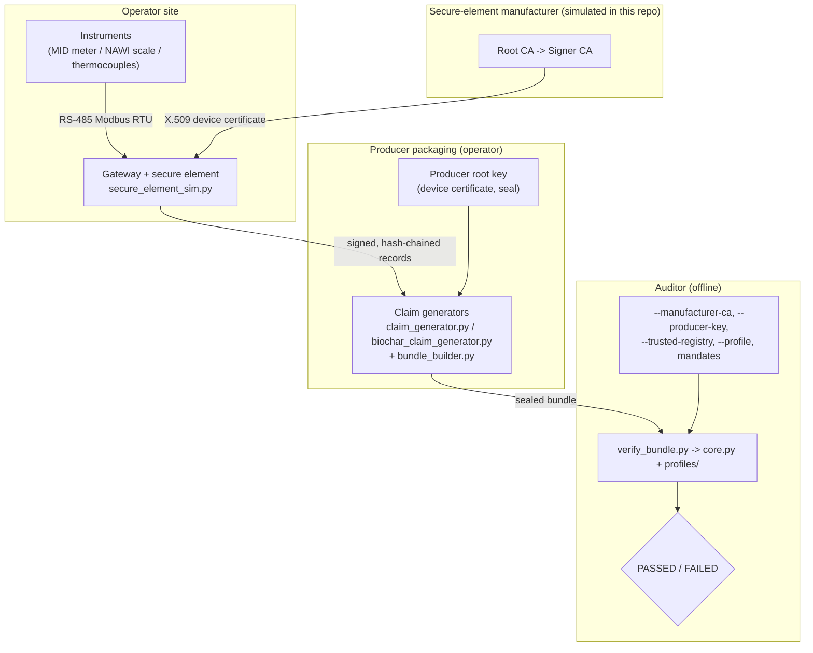

# System Architecture & Implementation (bundle format v1.3)

Architecture of the reference implementation. The normative format is
[`02_protocol/evidence_bundle_spec.md`](../02_protocol/evidence_bundle_spec.md); the threat model
is [`threat_model.md`](threat_model.md).

---

## 1. Parties and Data Flow



---

## 2. Components

| Path | Role |
|---|---|
| [`src/verifier/verify_bundle.py`](../src/verifier/verify_bundle.py) | CLI: argument handling, Check 0 (profile binding), human/JSON report. |
| [`src/verifier/core.py`](../src/verifier/core.py) | Shared core: Checks 1–4, 6, 7, 10, registry loading, ledger, audit report. |
| [`src/verifier/profiles/`](../src/verifier/profiles/) | Profile drivers: instrument requirements + hooks for Checks 5, 8, 9. |
| [`src/verifier/jcs.py`](../src/verifier/jcs.py) | RFC 8785 canonicalisation (integer-only profile) and strict JSON parser. |
| [`src/verifier/crypto.py`](../src/verifier/crypto.py) | OpenSSL CLI wrappers: ECDSA verify, X.509 chain validation, key fingerprints. |
| [`src/verifier/trusted_references.json`](../src/verifier/trusted_references.json) | Example auditor registry: pinned datasets (illustrative values) and methodology parameters. |
| [`src/device_simulator/secure_element_sim.py`](../src/device_simulator/secure_element_sim.py) | Simulated manufacturer PKI (labelled TEST ONLY), producer authority, secure element, device provisioning, record chaining. |
| [`src/device_simulator/mock_edge.py`](../src/device_simulator/mock_edge.py), [`mock_biochar_edge.py`](../src/device_simulator/mock_biochar_edge.py) | Profile-specific gateway simulators. |
| [`src/pipeline/bundle_builder.py`](../src/pipeline/bundle_builder.py) | Profile-agnostic packaging: claim, PROV graph, manifest and seal. |
| [`src/pipeline/claim_generator.py`](../src/pipeline/claim_generator.py), [`biochar_claim_generator.py`](../src/pipeline/biochar_claim_generator.py) | Profile-specific calculations and recipes (independent of the verifier's implementation). |
| [`src/attacks/`](../src/attacks/) | Fixtures, harness, insider toolkit, outsider/insider/biochar suites (40 vectors). |
| [`src/tools/freeze_golden_vectors.py`](../src/tools/freeze_golden_vectors.py) | Regenerates the golden conformance vectors. |
| [`04_experiments/`](../04_experiments/) | Golden vectors, JCS vectors, reference datasets, P1–P6 regression. |
| [`tests/`](../tests/) | Unit tests for JCS conformance and golden vectors. |

---

## 3. Lifecycle

```mermaid
sequenceDiagram
    autonumber
    participant M as Manufacturer CA
    participant G as Gateway (secure element)
    participant P as Producer packaging
    participant A as Auditor verifier

    M->>G: Issue X.509 certificate for the chip-generated key (factory)
    P->>P: Sign device certificate: key -> profile + instruments + calibration
    loop each interval / batch
        G->>G: record = {device_id, sequence, prev_hash, t_start, t_end, payload}
        G->>G: sign JCS(record); prev_hash(next) = SHA-256(JCS(record))
    end
    P->>P: Recompute metrics, write recipes, PROV graph, claim
    P->>P: Seal JCS({version, profile, claim_id, files})
    P-->>A: Bundle
    A->>A: Check 0-4: profile, seal, attestation chain to pinned CA, signatures, chain/gaps
    A->>A: Check 5, 8, 9 (profile): continuity, pinned references, conservation
    A->>A: Check 6, 7, 10: boundaries/mandates/ledger, lineage, exact reconciliation
```

---

## 4. Adding a Profile

1. Create `src/verifier/profiles/<name>.py` with `profile_id`, `instrument_requirements` and the
   three hooks (see the module docstring in `profiles/__init__.py`).
2. Register it in `PROFILE_DRIVERS`.
3. Add its methodology parameters to the auditor registry under
   `methodology_parameters.<profile_id>`.
4. Add a simulator, a claim generator and attack vectors; freeze a golden vector.

Profiles cannot change core checks; a new profile only adds domain invariants.
