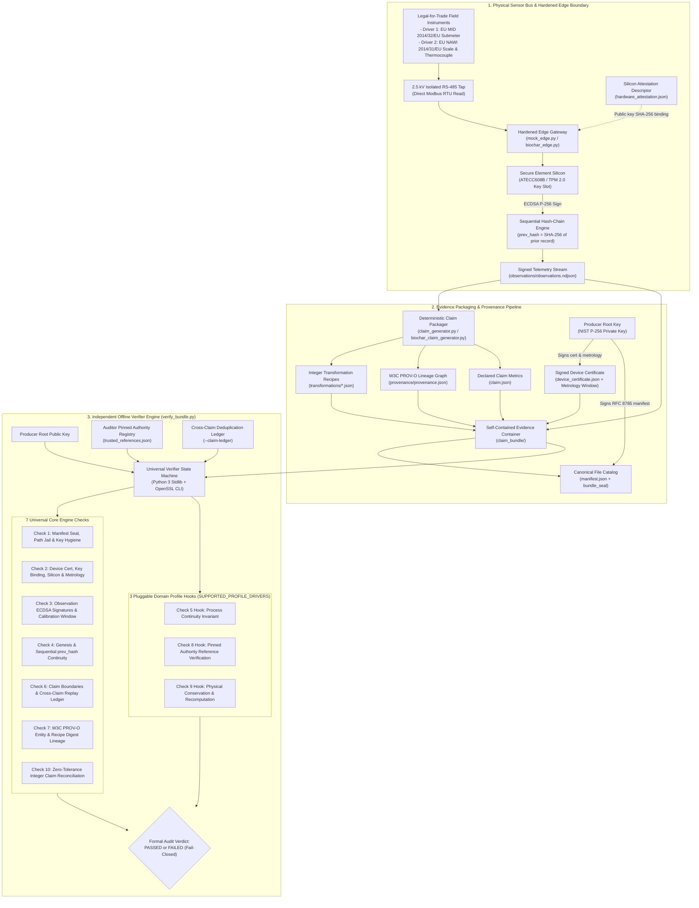
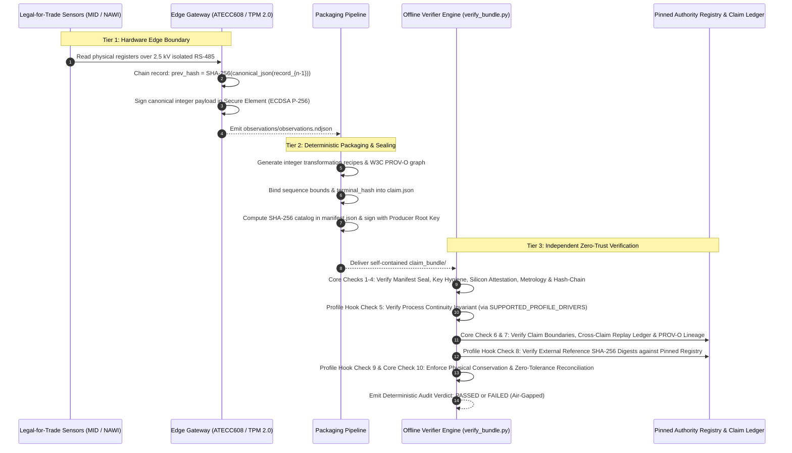

# System Architecture & Implementation (v1.2)

This directory documents the technical architecture, cryptographic data flow, pluggable profile dispatcher, and repository components of the **Universal Verifiable Telemetry Engine**.

---

## 1. Universal Engine Architecture & Data Flow

The system separates the **Core Cryptographic Verification Engine** (7 domain-agnostic checks) from **Pluggable Domain Profile Drivers** (3 invariant hooks dispatched via `SUPPORTED_PROFILE_DRIVERS`).

---

## 2. Directory & Component Mapping

| Directory / File | Architectural Layer | Description |
|---|---|---|
| [`src/verifier/verify_bundle.py`](../src/verifier/verify_bundle.py) | **Core Verifier Engine** | Universal zero-trust verification CLI executing the 7 core cryptographic/structural checks and dispatching the 3 pluggable domain hooks via `SUPPORTED_PROFILE_DRIVERS`. Supports `--list-profiles`, `--claim-ledger`, and `--require-hardware-attestation`. Zero pip dependencies. |
| [`src/verifier/trusted_references.json`](../src/verifier/trusted_references.json) | **Core Authority Registry** | Out-of-band auditor-pinned SHA-256 digests for authoritative reference datasets (ISPRA/EEA grid factors, ISO 17025 lab certificates, certified delivery manifests) and pinned `methodology_parameters`. |
| [`src/device_simulator/mock_edge.py`](../src/device_simulator/mock_edge.py) | **Reference Driver 1 (`energy_submetering`)** | Simulates EU MID 2014/32/EU Class B Modbus RTU dual registers (`cumulative_wh`, `interval_wh`), hardware attestation descriptor, sequential `prev_hash` chaining, and P-256 signing. |
| [`src/pipeline/claim_generator.py`](../src/pipeline/claim_generator.py) | **Reference Driver 1 (`energy_submetering`)** | Packages signed energy observations, integer Wh summation, Scope 2 GHG recipes, W3C PROV-O lineage, and root-sealed `manifest.json`. |
| [`src/device_simulator/biochar_edge.py`](../src/device_simulator/biochar_edge.py) | **Reference Driver 2 (`biochar_pyrolysis`)** | Simulates EU NAWI 2014/31/EU Class III weighing indicators and Type-K pyrolysis thermocouple buses, silicon attestation binding, and batch `prev_hash` signing. |
| [`src/pipeline/biochar_claim_generator.py`](../src/pipeline/biochar_claim_generator.py) | **Reference Driver 2 (`biochar_pyrolysis`)** | Packages multi-sensor pyrolysis batches, ISO 17025 lab assays, feedstock manifests, 6-part mass-balance conservation recipes, and W3C PROV-O lineage. |
| [`src/attacks/outsider_attacks.py`](../src/attacks/outsider_attacks.py) | **Core Engine Benchmark (`O1–O11`)** | Automated adversarial test suite verifying fail-closed rejection of 11 outsider tampering, spoofing, path traversal, and key-hygiene vectors. |
| [`src/attacks/insider_fraud_suite.py`](../src/attacks/insider_fraud_suite.py) | **Insider Benchmark (`I1–I5`)** | Automated test suite verifying rejection of 5 operator fraud vectors (reference factor greenwashing, dual-register shaving, period truncation, simulator key injection, stream splicing). |
| [`src/attacks/biochar_attacks.py`](../src/attacks/biochar_attacks.py) | **Domain Driver Stress Suite (`B1–B17`)** | Automated test suite verifying rejection of 17 multi-sensor physical & metrological fraud vectors (moisture inflation, thermal undercooking, unpinned lab reports, expired calibration, cross-claim replay, yield-cap violations). |
| [`04_experiments/security_reaudit/poc_exploits.py`](../04_experiments/security_reaudit/poc_exploits.py) | **Security Regression Harness (`P1–P6`)** | Automated regression harness validating all 6 security re-audit hardening fixes (`P1–P6`). |
| [`04_experiments/golden_test_vector/`](../04_experiments/golden_test_vector/) | **Golden Vector 1 (`energy_submetering`)** | Frozen reference bundle, public key, and expected JSON verdict for cross-language (Rust) conformance testing of linear cumulative flows. |
| [`04_experiments/golden_test_vector_biochar/`](../04_experiments/golden_test_vector_biochar/) | **Golden Vector 2 (`biochar_pyrolysis`)** | Frozen reference bundle, public key, and expected JSON verdict for cross-language conformance testing of non-linear mass transformations. |
| [`03_system/threat_model.md`](threat_model.md) | **Formal Threat Model** | Formal threat taxonomy, adversary capabilities, physical-to-digital security boundaries, and 33-vector benchmark mapping. |

---

## 3. Universal Cryptographic Lifecycle Sequence

