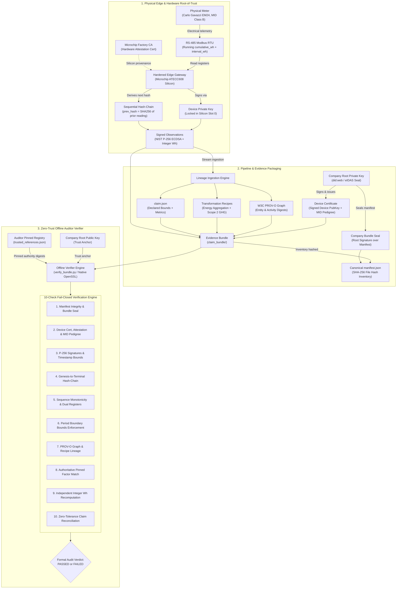
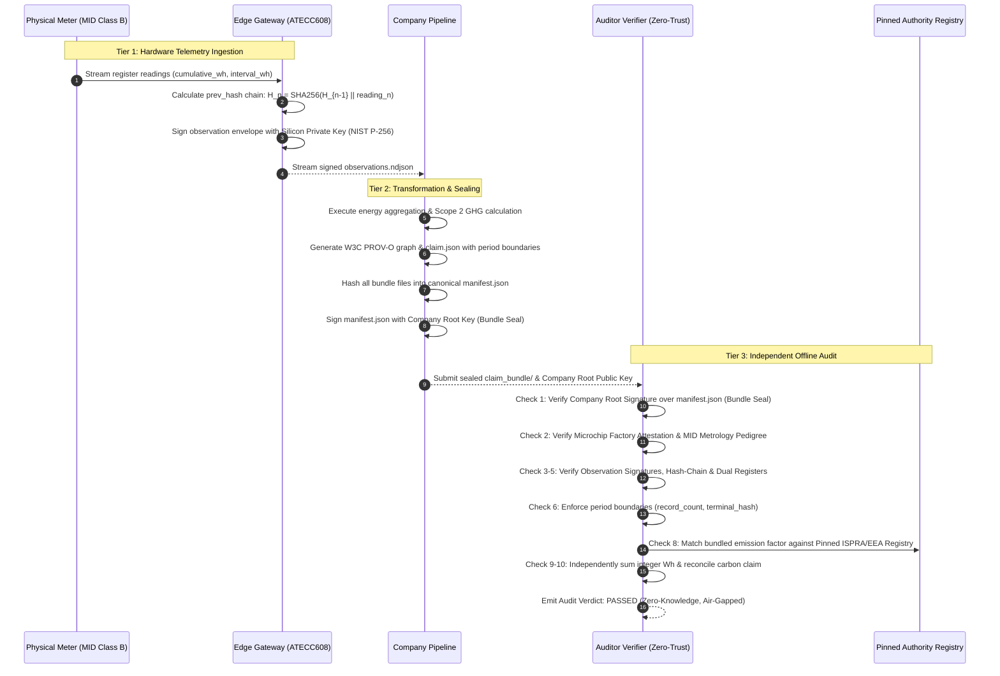

# Verifiable Telemetry (v1.2)

> **Open-Source Cryptographic dMRV & Hardware Root-of-Trust for High-Durability Carbon Removals (EU CRCF) and Statutory Energy Accounting**

[](LICENSE)
[]()
[]()
[]()
[]()

---

## Executive Summary

High-durability Carbon Dioxide Removal (CDR) and corporate ESG disclosures currently rest on a fragile foundation: **unauthenticated database queries, exported CSVs, and manual spreadsheets**. 

In high-durability carbon removal—such as industrial biochar pyrolysis certified under the **EU Carbon Removal Certification Framework (CRCF, Delegated Regulation (EU) 2026/285)**, **Puro.earth CORCs**, and the **European Biochar Certificate (EBC)**—each metric ton of permanent carbon removed commands \$100–\$200 in direct market cash. Yet validation and verification bodies (VVBs) must audit annual claims against easily manipulated spreadsheets, uncalibrated scale printouts, and unverified kiln logs. Without cryptographic binding, fraud vectors such as **water spraying (moisture inflation)**, **kiln thermal undercooking ($T < 500^\circ\text{C}$)**, **uncertified feedstock substitution**, and **period truncation** remain trivially undetectable.

**Verifiable Telemetry** bridges this trust gap by establishing an unbroken, mathematically auditable chain of custody from physical sensor tapping (RS-485 Modbus RTU Type-K thermocouples and EU 2014/31/EU NAWI legal scales) to statutory net removal claims.

### Modular Dual-Profile Architecture
1. **Primary Profile (`biochar_pyrolysis`):** High-durability carbon removal under EU CRCF, Puro.earth, and EBC. Binds continuous Type-K thermocouple logs ($T \ge 500^\circ\text{C}$), legal-for-trade scale indicators (EU 2014/31/EU NAWI), accredited ISO 17025 lab reports ($C_{\text{org}}$ and moisture), physical mass-balance invariants, and net tonnes $\text{CO}_2$ sequestered.
2. **Secondary Profile (`energy_submetering`):** Industrial electrical submetering under CSRD (Directive 2022/2464) and EPBD. Binds MID Class B electricity meters, dual-register deltas (integer cumulative Wh vs interval Wh), and pinned ISPRA grid emission factors.

### The Trust Boundary Philosophy
> *"We do not claim to solve all physical tampering in the universe. We make fraud require physical hardware tampering or multi-party collusion, instead of an unauthenticated database query or spreadsheet edit."*

---

## 3-Layer Security Architecture

### System Architecture & Data Flow



### End-to-End Cryptographic Lifecycle



---

## Key Features

1. **Zero External Dependencies:** Built entirely with Python 3 standard library and native POSIX OpenSSL CLI (`openssl dgst -sha256`). Runs in air-gapped auditor enclaves without `pip install`.
2. **Sequential Cryptographic Hash-Chains:** Each reading embeds `prev_hash`, preventing head/tail truncation, record reordering, and telemetry splicing.
3. **Dual-Register Meter Consistency:** Validates that interval energy matches physical running meter registers ($\text{cumulative\_wh}_t - \text{cumulative\_wh}_{t-1} == \text{interval\_wh}_t$).
4. **Metrological Pedigree Binding:** Cryptographically binds meter model, MID 2014/32/EU accuracy class, and factory calibration validity into the signed device certificate.
5. **Auditor-Pinned Reference Data:** Independent verification against pinned registry digests (`trusted_references.json`), neutralizing insider emission factor manipulation.
6. **RFC 8785 Deterministic Canonicalization:** Strict integer Watt-hour accounting eliminates cross-platform floating-point drift between Python and Rust.

---

## Quickstart Guide

### 1. Prerequisites
- Python 3.9+
- OpenSSL 3.x (native on macOS / Linux)
- Zero third-party pip dependencies required.

### 2. Primary Profile: Biochar Pyrolysis dMRV (EU CRCF / Puro.earth / EBC)

```bash
# Step 1: Simulate edge gateway tapping Type-K thermocouple + certified scale indicator (NAWI)
python3 src/device_simulator/mock_biochar_edge.py

# Step 2: Ingest telemetry stream, bind ISO 17025 lab report + FSC biomass manifest, and seal bundle
python3 src/pipeline/biochar_claim_generator.py

# Step 3: Run the independent zero-trust auditor verifier (10 fail-closed checks)
python3 src/verifier/verify_bundle.py biochar_bundle/ --company-key producer_root_public_key.pem
```

Expected biochar verifier output:
```text
======================================================================
 Independent Offline Verifier — Zero-Trust Biochar dMRV Audit (v1.2)
 Specification: 02_protocol/evidence_bundle_spec.md (biochar_pyrolysis)
 Standards: EU CRCF Delegated Regulation 2026/285 | Puro.earth | EBC
======================================================================
[*] Target Claim Bundle : biochar_bundle/
[*] Trust Anchor (Root) : producer_root_public_key.pem
----------------------------------------------------------------------
[Check 1/10] Manifest Integrity & Producer Bundle Seal : [PASSED]
[Check 2/10] Device Certificate & Scale Metrology (NAWI): [PASSED]
[Check 3/10] Batch Signatures & Temporal Bounds (ECDSA) : [PASSED] (5 batches)
[Check 4/10] Cryptographic Hash-Chain Continuity         : [PASSED]
[Check 5/10] Pyrolysis Thermal Permanence (T >= 500°C)  : [PASSED]
[Check 6/10] Claim Batch Boundary Bounds Enforcement    : [PASSED]
[Check 7/10] Transformation & W3C PROV-O Lineage Graph  : [PASSED]
[Check 8/10] Authoritative Reference Registry Pinning   : [PASSED]
[Check 9/10] Mass-Balance Invariants & CRCF Recomputation: [PASSED]
[Check 10/10] Numeric Claim Reconciliation (Zero-Tol): [PASSED]
----------------------------------------------------------------------
 FORMAL AUDIT VERIFICATION SUMMARY (EU CRCF / PURO.EARTH)
----------------------------------------------------------------------
  * Batches Ingested          : 5 batches (Unbroken hash-chain)
  * Thermal Permanence        : Confirmed (All batches >= 500°C)
  * Mass Balance Proof        : Net Dry Biochar = 8.500 tonnes
  * Net Carbon Sequestered    : 20.523166 t CO2 (20523166 g)
----------------------------------------------------------------------
[AUDIT VERDICT: PASSED]
  Status: Declared origin verified. Permanence verified. Lineage verified.
  All 10 specification checks passed without exception.
======================================================================
```

### 3. Secondary Profile: Industrial Energy Submetering (CSRD / EPBD)

```bash
# Step 1: Simulate electrical submeter edge gateway
python3 src/device_simulator/mock_edge.py

# Step 2: Transform cumulative Wh, link ISPRA grid factor, and seal evidence bundle
python3 src/pipeline/claim_generator.py

# Step 3: Run the independent zero-trust auditor verifier
python3 src/verifier/verify_bundle.py claim_bundle/ --company-key company_root_public_key.pem
```

---

## Adversarial Benchmark & Attack Suites

The pipeline includes comprehensive adversarial test suites programmatically asserting fail-closed rejection of **25 distinct fraud vectors**:

```bash
# Run biochar pyrolysis dMRV adversary suite (10 attack vectors)
python3 src/attacks/biochar_attacks.py

# Run outsider adversary suite (10 attack vectors)
python3 src/attacks/outsider_attacks.py

# Run insider corporate fraud suite (5 attack vectors)
python3 src/attacks/insider_fraud_suite.py
```

### Biochar dMRV Adversary Matrix (10/10 Caught)
| ID | Attack Vector | Verifier Defense | Verdict |
|---|---|---|:---:|
| **B1** | Water Spraying / Moisture Inflation Fraud | Physical mass-balance conservation invariant ($M_{\text{dry}} \le M_{\text{feedstock}}$) | ❌ Caught |
| **B2** | Thermal Undercooking ($T_{\min} < 500^\circ\text{C}$) | EU CRCF statutory thermal permanence invariant | ❌ Caught |
| **B3** | Counterfeit Lab Report (ISO 17025 Violation) | Auditor pinned reference registry validation | ❌ Caught |
| **B4** | Feedstock Cap Exhaustion (Used > Quota) | Cumulative biomass delivery manifest cap enforcement | ❌ Caught |
| **B5** | Dropped Batch / Selective Omission | Sequential cryptographic hash-chain continuity (`prev_hash`) | ❌ Caught |
| **B6** | Non-Certified Scale Indicator | EU Directive 2014/31/EU NAWI legal metrology check | ❌ Caught |
| **B7** | Software Key without Silicon Attestation | Microchip ATECC608 hardware attestation verification | ❌ Caught |
| **B8** | Uncertified Biomass Source | EBC positive list & pinned manifest registry verification | ❌ Caught |
| **B9** | Numeric Claim Inflation | Recomputed stoichiometry vs declared claim zero-tolerance match | ❌ Caught |
| **B10** | Revoked Kiln Gateway Rejection | Pinned `--revoked` device list enforcement | ❌ Caught |

### Outsider Adversary Matrix (10/10 Caught)
| ID | Attack Vector | Verifier Defense | Verdict |
|---|---|---|:---:|
| **O1** | Falsified Reading Value | NIST P-256 ECDSA observation signature failure | ❌ Caught |
| **O2** | Rogue Uncertified Public Key | Company root certificate chain validation failure | ❌ Caught |
| **O3** | Dropped Observation Record | Monotonic sequence check and hash-chain failure | ❌ Caught |
| **O4** | Duplicate Replay Record | Sequence uniqueness check | ❌ Caught |
| **O5** | Envelope Device ID Mismatch | Device ID consistency check vs certificate | ❌ Caught |
| **O6** | Expired / Future Timestamp | Temporal window check vs certificate validity | ❌ Caught |
| **O7** | Re-hashed Manifest Bypass | Company root bundle seal signature failure | ❌ Caught |
| **O8** | Path Traversal Injection (`../../`) | Strict relative path schema validation | ❌ Caught |
| **O9** | Unmanifested File Injection | Zero-tolerance bundle inventory check | ❌ Caught |
| **O10** | Revoked Gateway Rejection | Pinned `--revoked` device list enforcement | ❌ Caught |

### Insider Corporate Fraud Matrix (5/5 Caught)
| ID | Attack Vector | Verifier Defense | Verdict |
|---|---|---|:---:|
| **I1** | Emission Factor Greenwashing + Reseal | Auditor pinned reference registry check | ❌ Caught |
| **I2** | Dual-Register Interval Shaving | Meter register delta consistency check ($\Delta \text{cum} == \text{int}$) | ❌ Caught |
| **I3** | Period Head/Tail Truncation | Claim declared period boundaries vs audit mandate | ❌ Caught |
| **I4** | Unattested Software Simulator Key | Silicon hardware attestation chain validation | ❌ Caught |
| **I5** | Telemetry Splicing & Re-chaining | Sequential cryptographic hash continuity | ❌ Caught |

---

## Cross-Language Conformance Test Vectors

To support Milestone 3 (Rust rewrite of the verifier engine), this repository freezes immutable golden test vectors:
- **Biochar Pyrolysis:** [`04_experiments/golden_test_vector_biochar/`](04_experiments/golden_test_vector_biochar/)
- **Energy Submetering:** [`04_experiments/golden_test_vector/`](04_experiments/golden_test_vector/)

Verify the biochar golden vector:
```bash
python3 src/verifier/verify_bundle.py \
  04_experiments/golden_test_vector_biochar/biochar_bundle/ \
  --company-key 04_experiments/golden_test_vector_biochar/producer_root_public_key.pem \
  --json
```

---

## Repository Map

```text
├── 00_project/             # Roadmap, decision registers, NLnet application draft & trackers
├── 01_literature/          # Academic literature matrix, search protocols, and gap analysis
├── 02_protocol/            # Evidence Bundle Specification v1.2 & threat boundaries
├── 03_system/              # System architecture docs and formal threat model
├── 04_experiments/         # Golden test vectors (Biochar & Energy) and experiment registry
├── biochar_bundle/         # Verified Biochar dMRV evidence bundle (EU CRCF / Puro)
├── claim_bundle/           # Verified Energy Submetering evidence bundle (CSRD)
├── src/
│   ├── device_simulator/   # Edge simulators: mock_biochar_edge.py & mock_edge.py
│   ├── pipeline/           # Lineage generators: biochar_claim_generator.py & claim_generator.py
│   ├── verifier/           # Modular 10-check zero-trust verifier CLI & trusted registry
│   └── attacks/            # Biochar (10/10), outsider (10/10), and insider (5/5) test suites
├── LICENSE                 # Apache 2.0 Open-Source License
└── README.md               # Project documentation
```

---

## Roadmap & Milestones (NLnet Restack)

- [x] **Milestone 1:** Formal Data Specification & Dual Hardware Attestation Model (v1.2 Complete)
- [x] **Milestone 2:** End-to-End Edge Simulator, Claim Pipeline & Offline Verifier (v1.2 Complete)
- [ ] **Milestone 3:** Formal Rust Verifier Rewrite & Cross-Language Determinism Testing
- [ ] **Milestone 4:** Operational Field Pilot in a Commercial Biochar Pyrolysis Facility

---

## License

This project is licensed under the **Apache License 2.0**. See the [LICENSE](LICENSE) file for details.
