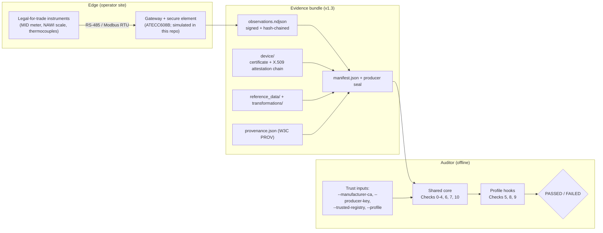

# Verifiable Telemetry Engine

> Open, offline-verifiable evidence format and toolchain for industrial sensor telemetry:
> hardware-held signing keys at the edge, a self-contained evidence bundle, and an independent
> verifier with a shared core and pluggable domain profiles.

[](LICENSE)
[]()
[](02_protocol/evidence_bundle_spec.md)
[](#7-tests)

**Status:** working Python prototype. The secure-element PKI is **simulated** (clearly labelled
test CA); real ATECC608B hardware, trusted time and transparency-log anchoring are planned work
(see [§8](#8-limitations--roadmap)).

---

## 1. The Problem

Compliance claims (energy use, Scope 2 emissions, carbon removal, ...) are built from sensor
readings that pass through systems the reporting operator fully controls: PLC/SCADA servers,
SQL databases, spreadsheets, vendor clouds. TLS protects data in transit against outsiders; it
does nothing against the operator, who can shave intervals, drop bad batches, ignore expired
calibrations or pick favourable conversion factors before an auditor ever sees the data.

This project provides the missing open layer between the instrument and the audit:

* **Edge:** a gateway reads legal-for-trade instruments over RS-485/Modbus, encodes readings as
  integers, signs each record with a key held in a secure element and links records into a
  SHA-256 hash chain.
* **Evidence bundle:** signed records, the device certificate and its manufacturer attestation
  chain, pinned reference data, calculation recipes and a W3C PROV lineage graph, sealed into one
  self-contained directory ([spec v1.3](02_protocol/evidence_bundle_spec.md)).
* **Verifier:** a zero-dependency CLI (Python stdlib + OpenSSL; Rust port planned) that an auditor
  runs fully offline. All trust anchors (manufacturer CA, producer key, reference registry,
  profile) come from the auditor, never from the bundle.

---

## 2. Architecture



### Verification checks

| # | Layer | Check |
|:-:|---|---|
| 0 | Core | **Profile binding:** the auditor selects the profile; the bundle must declare the same one. |
| 1 | Core | **Manifest & seal:** file hashes, safe paths, no unmanifested files, no private keys, producer seal over files + profile + claim id. |
| 2 | Core | **Device & attestation:** device key's X.509 chain validates against the **auditor-pinned manufacturer root**; producer-signed device certificate bound to that key; required metrology instruments (standard, class, calibration); revocation. |
| 3 | Core | **Record signatures:** ECDSA P-256 over RFC 8785 canonical JSON; certificate window; calibration expiry. |
| 4 | Core | **Chain continuity:** `prev_hash` chain, contiguous sequence, timestamp order, maximum gap between records (withheld data). |
| 5 | Profile | **Process continuity** (e.g. dual-register meter delta; minimum pyrolysis temperature). |
| 6 | Core | **Claim boundaries:** period = evidence; auditor mandates (`--expected-count`, `--period-start/--period-end`); `--claim-ledger` double-counting check. |
| 7 | Core | **Lineage:** every input and recipe is a PROV entity with matching hash; acyclic; all inputs are ancestors of the claim. |
| 8 | Profile | **Pinned references:** reference files' SHA-256 and dataset type pinned in the auditor registry. |
| 9 | Profile | **Conservation & recomputation** in integer arithmetic (mass balance, yield caps, delivery caps, Wh sums). |
| 10 | Core | **Reconciliation:** declared metrics must equal recomputed metrics exactly. |

Encoding: RFC 8785 JCS restricted to integers; the parser rejects floats, duplicate keys and
unsafe integers. Units: Wh, g, °C, basis points, mg CO2e/kWh.

---

## 3. Profiles

A profile is data plus three hooks ([`src/verifier/profiles/`](src/verifier/profiles/)); it
cannot override core checks. List them with `python3 src/verifier/verify_bundle.py --list-profiles`.

| Profile | Instruments | Check 5 | Check 8 | Check 9 metrics |
|---|---|---|---|---|
| `energy_submetering` | MID energy meter | `Δ cumulative_wh == interval_wh`, certified meter id | grid emission factor (mg CO2e/kWh) | total Wh; emissions g CO2e (rounded up) |
| `biochar_pyrolysis` | NAWI weighing indicator; IEC 60584-1 thermocouple module | `T_min ≥ min_pyrolysis_temp_c`, `T_min ≤ T_avg ≤ T_max`, unique batches | ISO 17025 lab assay bound to the batch range; feedstock delivery manifest | per-batch dry yield cap; feedstock ≤ delivered; H/C_org cap; CRCF net removal g CO2 (rounded down) |

Methodology parameters (thresholds, caps, deductions) are read from the auditor registry
(`methodology_parameters.<profile>`); the code has no defaults.

---

## 4. Quickstart

Prerequisites: Python 3.9+ and an OpenSSL CLI (3.x tested). No pip packages.

```bash
# Energy submetering: simulate gateway, package claim, verify
python3 src/device_simulator/mock_edge.py          # -> build/energy_bundle, build/keys
python3 src/pipeline/claim_generator.py
python3 src/verifier/verify_bundle.py build/energy_bundle \
  --profile energy_submetering \
  --producer-key build/keys/producer_root_public_key.pem \
  --manufacturer-ca build/keys/manufacturer_pki/manufacturer_root_ca.pem \
  --trusted-registry src/verifier/trusted_references.json

# Biochar pyrolysis
python3 src/device_simulator/mock_biochar_edge.py  # -> build/biochar_bundle
python3 src/pipeline/biochar_claim_generator.py
python3 src/verifier/verify_bundle.py build/biochar_bundle \
  --profile biochar_pyrolysis \
  --producer-key build/keys/producer_root_public_key.pem \
  --manufacturer-ca build/keys/manufacturer_pki/manufacturer_root_ca.pem \
  --trusted-registry src/verifier/trusted_references.json
```

`build/` is git-ignored and holds all simulator keys. The verdict reports
`hardware_attestation: SIMULATED_MANUFACTURER_CA` and a warning, because the pinned root is the
simulation CA.

### CLI reference

| Flag | Purpose |
|---|---|
| `--profile` | **Required.** Rule set chosen by the auditor. |
| `--producer-key` | Producer root public key (device certificate + bundle seal). `--company-key` is an alias. |
| `--manufacturer-ca` | Secure-element manufacturer root CA (PEM). Without it Check 2 fails. |
| `--trusted-registry` | Pinned reference datasets and methodology parameters. |
| `--expected-count`, `--period-start`, `--period-end` | Auditor mandates against truncation. |
| `--prev-terminal-hash` | Link to the previous reporting period's chain. |
| `--revoked` | Device ids (comma list or file). |
| `--claim-ledger`, `--record-ledger` | Local double-counting ledger. |
| `--json`, `--json-out`, `-v`, `--list-profiles` | Output options. |

---

## 5. Threat Model in Brief

Full model: [`03_system/threat_model.md`](03_system/threat_model.md).

* **Outsiders** (no keys) cannot alter a bundle without failing Checks 1–4.
* **The operator** holds the producer key and controls the gateway, so its secure element signs
  whatever it is given. Insider fraud is therefore caught only by controls the operator does not
  hold: the manufacturer attestation chain (no software keys), auditor-pinned references,
  physical conservation checks, lineage rules and auditor mandates.
* **What this does not stop:** fabricated readings fed to a genuine gateway (needs firmware
  attestation / independent tamper sealing), a spoofed device on the unauthenticated RS-485 bus,
  manipulation of the physical inputs themselves (what is put on the scale, which sample goes to
  the lab), and clock manipulation (no trusted time yet).

The goal is not to make fraud impossible but to remove *costless* fraud: falsifying a verified
claim requires physical intervention at the instrument or gateway, or the cooperation of a party
the operator does not control, instead of a spreadsheet edit.

---

## 6. Golden Conformance Vectors

Frozen bundles plus auditor trust inputs and expected verdicts, for the planned Rust verifier and
any other implementation:

* [`04_experiments/golden_test_vector/`](04_experiments/golden_test_vector/) — `energy_submetering`
* [`04_experiments/golden_test_vector_biochar/`](04_experiments/golden_test_vector_biochar/) — `biochar_pyrolysis`
* [`04_experiments/conformance/jcs_vectors.json`](04_experiments/conformance/jcs_vectors.json) — RFC 8785 canonicalisation vectors (transcribed from the RFC)

Regenerate with `python3 src/tools/freeze_golden_vectors.py`.

---

## 7. Tests

```bash
make test        # unit tests + all attack suites + P1-P6 regression
```

The attack suites are a **regression suite written by the author**, not an external security
evaluation. Each vector must fail the specific check it targets; a crash never counts as a catch.

| Suite | Vectors | Covers |
|---|---|---|
| [`outsider_attacks.py`](src/attacks/outsider_attacks.py) | 13 (O1–O13) | payload/record tampering, dropped/replayed records, manifest re-hash, path traversal, unmanifested files, revoked device, private keys, duplicate-key and float injection |
| [`insider_fraud_suite.py`](src/attacks/insider_fraud_suite.py) | 8 (I1–I8) | unpinned emission factor, register shaving, truncation vs count and period mandates, removed attestation, splicing, withheld window re-signed and renumbered, undeclared recipe |
| [`biochar_attacks.py`](src/attacks/biochar_attacks.py) | 19 (B1–B19) | yield/conservation breaches, undercooking, counterfeit lab and feedstock data, uncertified scale, foreign or forged attestation chains, claim inflation, expired calibration, double counting, profile substitution, wrong reference type |
| [`poc_exploits.py`](04_experiments/security_reaudit/poc_exploits.py) | 6 (P1–P6) | regressions for the Oct 2026 re-audit findings |

Insider vectors re-sign records through the device key and re-seal with the producer key, so they
test the controls that remain when the operator holds both.

---

## 8. Limitations & Roadmap

Not implemented yet (also listed in spec §7):

* Real ATECC608B provisioning and an RS-485 ingestion daemon (simulated today).
* Firmware attestation / measured boot of the gateway.
* Trusted time (RFC 3161) and anchoring of chain heads in a public, witnessed transparency log
  (C2SP tlog / IETF SCITT-compatible); today's double-counting ledger is local to one auditor.
* Idle heartbeats to separate legitimate downtime from withheld data.
* Standalone Rust verifier.

---

## 9. Repository Map

```text
├── 00_project/          # Roadmap, decisions, NLnet application draft and trackers
├── 01_literature/       # Literature matrix and gap analysis
├── 02_protocol/         # Evidence bundle specification (v1.3)
├── 03_system/           # Architecture and threat model
├── 04_experiments/      # Golden vectors, JCS conformance vectors, reference data, re-audit PoCs
├── src/
│   ├── verifier/        # verify_bundle.py (CLI), core.py, jcs.py, crypto.py, profiles/
│   ├── device_simulator/# secure_element_sim.py (simulated PKI), mock_edge.py, mock_biochar_edge.py
│   ├── pipeline/        # bundle_builder.py, claim generators
│   ├── attacks/         # fixtures, harness, insider toolkit, attack suites
│   └── tools/           # freeze_golden_vectors.py
├── tests/               # unit tests (JCS, golden vectors)
└── Makefile
```

## License

Apache License 2.0 — see [LICENSE](LICENSE).
