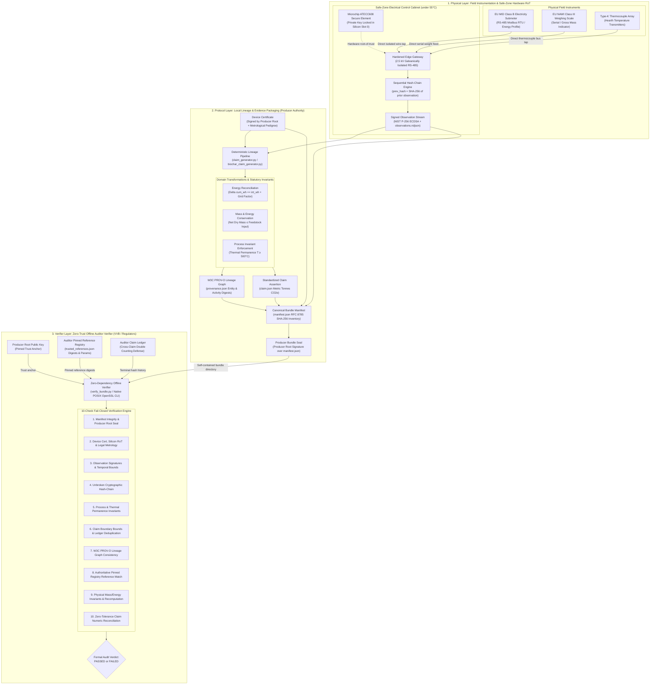
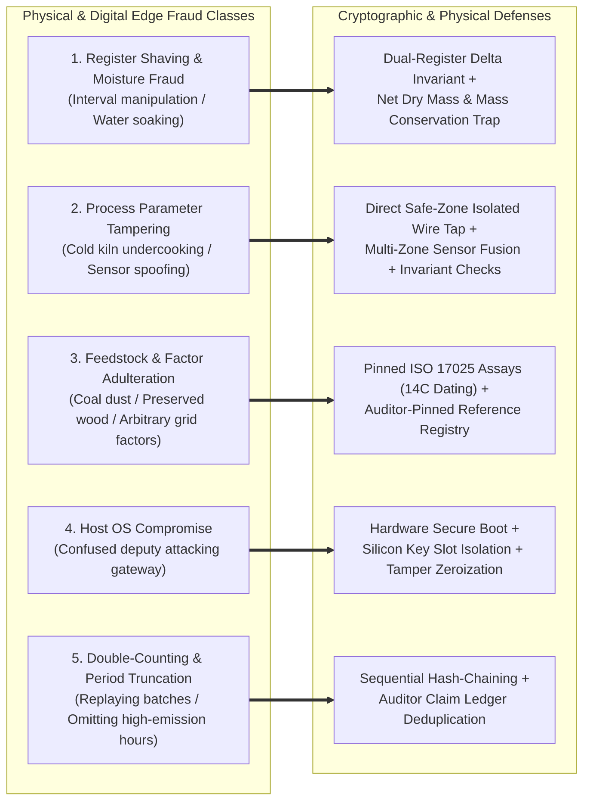
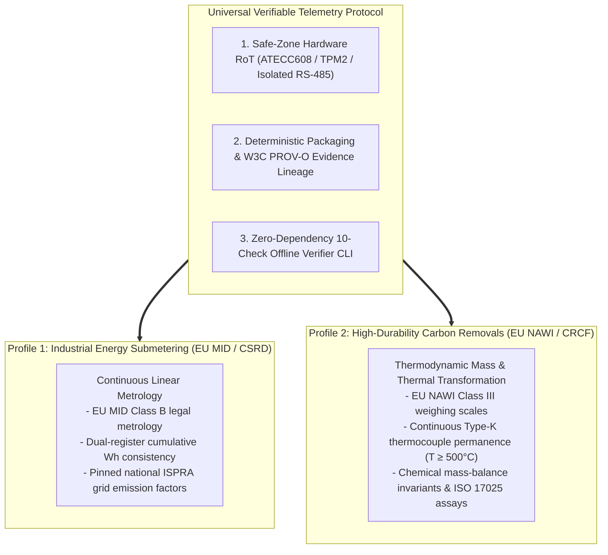

# Verifiable Telemetry (v1.2)

> **Universal Open-Source Hardware Root-of-Trust & Local-First Cryptographic Provenance for Industrial IoT (EU MID & NAWI / CSRD & CRCF)**

[](LICENSE)
[]()
[]()
[]()
[]()
[]()
[]()

---

## Executive Summary

Today, physical telemetry across Industrial IoT (submetering, manufacturing, grid energy, process heat, and environmental compliance) lacks an open, trustworthy internet architecture. Millions of industrial edge sensors are funneled into closed, proprietary cloud silos ("dark stacks"), unauthenticated SQL databases, and manual spreadsheets where operational telemetry can be silently altered, trimmed, or falsified before regulatory audit without leaving any cryptographic footprint.

When physical operations carry high-stakes financial or statutory consequences—such as corporate ESG disclosures (**CSRD Directive 2022/2464**) and high-durability carbon removals (**EU CRCF Delegated Regulation 2026/285**, where permanent removal credits command **\$100–\$200/tonne**)—auditors, regulators, and validation and verification bodies (VVBs) are forced to audit claims against easily manipulated CSV exports, uncalibrated instrument printouts, and opaque private dashboards. Without cryptographic binding directly at the physical instrument boundary, fraud vectors such as **meter register shaving**, **interval omission**, **moisture inflation (water spraying)**, and **process temperature tampering** remain undetectable.

**Verifiable Telemetry** restacks the physical-to-internet trust boundary with an open-source, local-first engine. A hardened edge gateway captures raw physical sensor telemetry directly at the physical measurement wire (via 2.5 kV galvanically isolated RS-485 Modbus RTU, pulse, or serial loops), cryptographically signing readings inside hardware secure elements (Microchip ATECC608 in Silicon Slot 0, TPM 2.0, or DICE) into an unbroken cryptographic hash-chain. Self-contained W3C PROV-O evidence bundles allow independent auditors to verify physical origin, statutory invariant compliance, mass/energy conservation, and mathematical reconciliations **100% offline with zero cloud vendor lock-in and zero third-party dependencies**.

### Dual Regulatory Proving Grounds

To demonstrate that the protocol is universal rather than single-industry, Verifiable Telemetry implements two reference profiles covering the two primary physical measurement paradigms of industrial telemetry:

1. **Profile 1: Industrial Energy Submetering (`energy_submetering`):**
   * **Physical Paradigm:** Continuous linear electrical metrology.
   * **Regulatory Mandate:** EU Corporate Sustainability Reporting Directive (**CSRD Directive 2022/2464**) and Energy Performance of Buildings Directive (**EPBD**).
   * **Invariants Enforced:** EU Directive 2014/32/EU (MID Class B) meter metrology, dual-register integer consistency (`Δ cumulative_wh == interval_wh`), and pinned national grid emission factors (e.g., ISPRA).
2. **Profile 2: High-Durability Carbon Removals (`biochar_pyrolysis`):**
   * **Physical Paradigm:** Non-linear thermodynamic mass and thermal transformation.
   * **Regulatory Mandate:** EU Carbon Removal Certification Framework (**EU CRCF Delegated Regulation 2026/285**), **Puro.earth CORCs**, and the **European Biochar Certificate (EBC)**.
   * **Invariants Enforced:** EU Directive 2014/31/EU (NAWI Class III) legal-for-trade scale metrology, continuous Type-K thermocouple thermal permanence ($T_{\min} \ge 500^\circ\text{C}$), accredited ISO 17025 lab assays, and first-law physical mass-balance conservation ($M_{\text{dry}} \le M_{\text{feedstock}}$).

### The Trust Boundary Philosophy
> *"We do not claim to solve all physical tampering in the universe. We make fraud require physical hardware tampering or multi-party institutional collusion, instead of an unauthenticated database query or spreadsheet edit."*

---

## 3-Layer Universal Restack Architecture

### System Architecture & Data Flow



### End-to-End Cryptographic Lifecycle

```mermaid
sequenceDiagram
    autonumber
    participant S as Physical Instruments (MID Submeter / NAWI Scale / Thermocouple)
    participant G as Edge Gateway (Silicon RoT ATECC608 + 2.5 kV Isolated Bus)
    participant P as Producer Pipeline (Local Claim Generator & PROV-O Engine)
    participant V as Offline Auditor Verifier (Air-Gapped POSIX CLI)
    participant R as Auditor Pinned Registry (trusted_references.json)

    Note over S,G: Layer 1: Hardware Root-of-Trust at the Wire (Safe Zone)
    S->>G: Raw serial / Modbus registers (energy Wh, scale mass g, hearth temp °C)
    G->>G: Verify local process invariants (e.g., T_min ≥ 500°C or cum_wh delta)
    G->>G: Compute sequential hash-chain link: H_n = SHA-256(H_{n-1} || payload_n)
    G->>G: Sign observation envelope inside secure element (NIST P-256 ECDSA)
    G-->>P: Stream signed observations.ndjson with unbroken hash-chain

    Note over P: Layer 2: Transformation, Lineage & Cryptographic Bundle Sealing
    P->>P: Ingest observations & bind authoritative reference digests (lab assays / grid factors)
    P->>P: Enforce domain conservation laws (mass conservation M_dry ≤ M_in, energy consistency)
    P->>P: Compute statutory regulatory metrics (EU CSRD Scope 2 / EU CRCF net removals)
    P->>P: Generate W3C PROV-O graph (provenance.json) and formal claim (claim.json)
    P->>P: Compute canonical manifest.json hash inventory across all bundle files
    P->>P: Cryptographically seal manifest.json with Producer Root Key (Bundle Seal)

    Note over V,R: Layer 3: Zero-Trust Offline Audit (Air-Gapped Auditor / VVB)
    P-->>V: Submit self-contained evidence bundle & Producer Root Public Key
    V->>V: Check 1: Verify Producer Root Signature over manifest.json (Bundle Seal)
    V->>V: Check 2: Verify ATECC608 Silicon RoT & MID / NAWI Legal Metrology Certificates
    V->>V: Check 3-4: Verify ECDSA Observation Signatures & Hash-Chain Continuity
    V->>V: Check 5: Verify Process & Thermal Permanence Invariants across all records (T ≥ 500°C)
    V->>R: Check 8: Match Lab Assays, Biomass Manifests, or Grid Factors vs Auditor Registry
    V->>V: Check 9: Recompute statutory metrics from raw telemetry; assert physical conservation
    V->>V: Check 10: Match recomputed results against declared claim.json (Zero-Tolerance)
    V-->>V: Emit Formal Audit Verdict: [AUDIT VERDICT: PASSED]
```
---

## Foundational European Statutory Metrology & Open Standards

To withstand legal and financial audits, industrial telemetry cannot rely on self-attested operational claims or proprietary cloud dashboards. Verifiable Telemetry grounds its verification rules in statutory European metrology, corporate reporting directives, and open internet provenance standards:

1. **Harmonized European Legal Metrology Directives:**
   * **EU Directive 2014/32/EU (Measuring Instruments Directive - MID):** Governs active electrical energy meters (Class B accuracy, $\le 1.0\%$ error). Our energy profile cryptographically binds MID meter serial numbers, calibration validity, and dual-register integrity into the signed device certificate.
   * **EU Directive 2014/31/EU (Non-Automatic Weighing Instruments - NAWI):** Governs legal-for-trade industrial scale indicators (Class III accuracy) used for certified batch mass measurement. Our biochar profile enforces NAWI certificate binding, rejecting uncertified load cells fail-closed.
2. **Statutory Corporate Disclosures & Carbon Removal Frameworks:**
   * **EU Directive 2022/2464/EU (Corporate Sustainability Reporting Directive - CSRD) & EPBD:** Mandates statutory Scope 1 & Scope 2 greenhouse gas reporting and energy performance audits across EU enterprises. Requires unbroken provenance from meter registers to ESG filings.
   * **EU Delegated Regulation (EU) 2026/285 (Carbon Removals Certification Framework - CRCF):** Statutory EU regulation defining permanent biochar removals. Mandates continuous thermal permanence ($T \ge 500^\circ\text{C}$), organic molar ratio $\text{H/C}_{\text{org}} \le 0.70$, net lifecycle accounting ($E_{\text{net}} = E_{\text{gross}} - E_{\text{leakage}} - E_{\text{process}}$), and accredited ISO 17025 lab assays.
   * **Voluntary Carbon Standards (Puro.earth, EBC, Isometric, ICVCM):** Enforce independent VVB third-party audits, certified feedstock positive lists (e.g., `EBC-1.1-FOREST`), and conservative uncertainty bounds.
3. **Open Internet Protocols & Cryptographic Commons:**
   * **W3C PROV-O (Provenance Ontology):** Standardized, machine-readable directed acyclic graph capturing entities, activities, and cryptographic derivations across the entire lifecycle.
   * **RFC 8785 (JSON Canonicalization Scheme - JCS):** Deterministic, byte-level hash stabilization across platforms and runtimes.
   * **NIST P-256 (secp256r1) & SHA-256:** Standard asymmetric ECDSA signatures compatible with hardware secure elements (Microchip ATECC608, TPM 2.0, DICE).

---

## Physical-to-Digital Boundary & Fraud Defense Architecture

In industrial IoT and digital Measurement, Reporting, and Verification (dMRV), cryptographically securing data *after* it enters a gateway is necessary, but insufficient on its own. A trustworthy architecture must defend the **physical-to-digital boundary**—the physical seam between plant machinery and electrical sensors where real-world manipulation occurs.

Verifiable Telemetry categorizes and mitigates the five universal edge fraud classes:



### 1. Register Shaving & Moisture / Mass Fraud
* **The Attack:** In energy submetering, an operator manipulates interval telemetry registers to report lower peak-demand electricity usage while cumulative registers count up. In biomass/biochar, water quenching is physically required for fire safety as char exits at $>500^\circ\text{C}$; a dishonest operator hoses down the output pile with excess water to artificially inflate scale weight ($M_{\text{wet}}$).
* **The Restack Defense:**
  1. *Dual-Register Integer Consistency (Energy):* Verifier Check 9 asserts that cumulative meter register deltas strictly match interval sums: `Δ cumulative_wh == Σ interval_wh` (**Attack I2 Caught**).
  2. *Strict Net Dry Mass Quantification (Biochar):* Carbon credits are never awarded on scale weight. Credits are calculated strictly on dry mass:
     $$M_{\text{dry}} = M_{\text{wet}} \times (1 - \text{moisture})$$
     Programmatically calculated via integer basis points: `M_dry = M_wet * (10000 - moisture_bps) // 10000`.
  3. *The Inescapable Mass Conservation Trap:* Excess water spraying elevates laboratory moisture assays (e.g., 35.00%), automatically discounting wet mass. If an operator attempts to forge the lab assay to declare artificially low moisture, the resulting calculated dry mass mathematically violates the first law of thermodynamics:
     $$M_{\text{dry}} > M_{\text{feedstock}}$$
     Verifier Check 9 enforces aggregate mass conservation and a statutory **40.00% maximum dry yield bound** pinned in `trusted_references.json` (**Attacks B1, B15 & B16 Caught**).

### 2. Process Parameter Tampering & Analog Sensor Spoofing
* **The Attack:** Silicon microchips melt above $125^\circ\text{C}$; therefore, physical sensors inside industrial reactors (kilns, furnaces) must be analog thermocouples (Type-K). An operator runs a kiln at an energy-saving $350^\circ\text{C}$ (producing unstable charcoal rather than permanent biochar), manipulating SCADA/PLC software registers or placing a localized blowtorch on a probe tip.
* **The Restack Defense:**
  1. *Direct Safe-Zone Wire Tapping:* The edge gateway resides inside a locked electrical cabinet in the safe zone ($<55^\circ\text{C}$), tapping the physical RS-485 Modbus wire directly using 2.5 kV galvanically isolated transceivers. This bypasses the plant SCADA/PLC software entirely, preventing register override.
  2. *Continuous Invariant Enforcement (Check 5):* The verifier inspects minimum operating parameters across every batch observation. Any batch where $T_{\min} < 500^\circ\text{C}$ causes an immediate fail-closed audit rejection (**Attack B2 Caught**).
  3. *Multi-Zone Sensor Fusion:* Tapping multi-point thermocouple arrays and cross-correlating temperature with induced draft fan current draw and differential pressure detects localized probe spoofing.

### 3. Feedstock & Factor Adulteration (The "Garbage In" Problem)
* **The Attack:** Physical scales measure gravitational mass, not chemical composition. An operator blends cheap fossil coal dust, lignite, or toxic demolition wood treated with Chromated Copper Arsenate (CCA) into biomass feed to multiply carbon yield at low cost. In energy, operators cherry-pick outdated or favorable grid emission factors to greenwash Scope 2 emissions.
* **The Restack Defense:**
  1. *Auditor-Pinned Reference Registry (Check 8):* All lab assays and grid factors must match SHA-256 digests pinned in the auditor's independent reference registry (`trusted_references.json`), neutralizing post-hoc modifications (**Attacks I1 & B3 Caught**).
  2. *$^{14}\text{C}$ Radiocarbon Isotopic Dating:* Biogenic biomass contains $100\%\text{ Fraction Modern Carbon}$ ($^{14}\text{C}$), whereas fossil coal has zero $^{14}\text{C}$ due to radioactive decay over millions of years ($t_{1/2} = 5,730\text{ years}$). Fossil fuel adulteration is immediately caught in mandatory ISO 17025 assays.
  3. *Cumulative Feedstock Quota Capping (Check 9):* Cumulative feedstock across verified batches cannot exceed the total verified biomass quota on the delivery manifest, preventing ghost-truck double billing (**Attacks B4 & B8 Caught**).

### 4. Host OS Compromise (The Confused Deputy Attack)
* **The Attack:** The Microchip ATECC608 secure element prevents private key extraction via physical side-channel resistance. However, an attacker who compromises the gateway Linux host could instruct the secure element to sign forged telemetry.
* **The Restack Defense:**
  1. *Hardware Secure Boot:* The host processor bootloader verifies the digital signature of the kernel and firmware against ROM-fused manufacturer keys before execution.
  2. *Cabinet Tamper Detection & Key Zeroization:* The gateway is housed in a locked control cabinet with chassis intrusion microswitches. Physical intrusion triggers hardware zeroization, permanently erasing private keys locked in silicon slot 0 (**Attack B7 Caught**).

### 5. Double Counting, Period Truncation & Downstream Leakage
* **The Attack:** An operator re-issues the same telemetry under multiple claim IDs, drops low-efficiency or high-emission intervals, or burns sequestered biochar as fuel after minting credits.
* **The Restack Defense:**
  1. *Cryptographic Hash-Chain Continuity (Check 4):* Sequential `prev_hash` links make record dropping or interval splicing mathematically impossible without breaking the chain (**Attacks O3 & I5 Caught**).
  2. *Auditor Claim Ledger (Check 6):* Offline ledger checking (`--claim-ledger PATH`) tracks batch IDs and terminal hashes across evidence bundles, preventing cross-claim double-counting (**Attacks B14 & O4 Caught**).
  3. *W3C PROV-O Downstream Lineage:* Evidence bundles bind GPS-stamped field application receipts, proving permanent soil incorporation or concrete encapsulation before credit retirement.

---

## Scope Boundary Matrix: What Cryptography Enforces vs Physical Metrology

| Fraud Vector | Can Software / Math Alone Solve It? | In-Scope Restack Cryptographic Defense | Complementary Physical / Metrological Control |
|---|:---:|---|---|
| **Register Shaving (Energy)** | Yes | **Check 9 Invariant:** Cumulative delta matches interval sum (`Δ cum == Σ int`) | EU MID Class B calibrated meter with factory lead seals |
| **Water Spraying (Biochar)** | No (cannot stop physical water hoses) | **Net Dry Mass Formula** + **Check 9 Mass Conservation Trap** ($M_{\text{dry}} \le M_{\text{feedstock}}$) | Composite sampling under ISO 17025 laboratory protocol |
| **Cold Process / Reactor Undercooking** | Yes | **Check 5 Invariant:** Continuous $T_{\min} \ge 500^\circ\text{C}$ signed at source; fails closed | Direct Modbus RS-485 tap inside safe-zone cabinet + Sensor Fusion |
| **Fossil Fuel / Adulterated Feedstock** | No (scales measure mass, not chemistry) | **Check 8 Pinned Reference Match:** Lab assay digest pinned in auditor registry | ISO 17025 $^{14}\text{C}$ radiocarbon dating & ICP-MS metal screening |
| **Scale / Meter Calibration Drift** | Yes | **Check 2 Metrological Pedigree:** EU MID / NAWI certificate validity binding | Periodic physical recalibration by accredited metrology authorities |
| **Dropping Failed / High-Emission Batches** | Yes | **Check 4 Hash-Chain Continuity:** Sequential `prev_hash` prevents record omission | Monotonic hardware sequence counters locked in ATECC608 silicon |
| **Post-Hoc Spreadsheet / DB Edits** | Yes | **Check 1 Bundle Seal:** Producer Root signature over canonical SHA-256 manifest | eIDAS Qualified Electronic Seal / Enterprise PKI trust anchor |
| **Sensor Cable Disconnection / Spoofing** | Partial | **Direct Cabinet Tapping:** Bypasses SCADA software registers; 2.5 kV galvanic isolation | Armored conduit, locked cabinet, chassis intrusion tamper switches |
| **Double-Counting / Cross-Claim Replay** | Yes | **Check 6 Claim Ledger:** Programmatic deduplication of batch IDs and terminal hashes | Cross-registry serial retirement protocols (Puro, EBC, national registries) |

### The "Collusion-Forcing" Security Thesis
> **Core Principle:** Verifiable Telemetry does not claim to eliminate all physical reality exploits. Instead, it alters the economic and operational attack surface:
> * **Today:** Operators commit multi-million-euro energy or carbon fraud with **zero physical traces** by altering an Excel cell, modifying an unauthenticated SQL database row, or re-exporting a CSV.
> * **With Verifiable Telemetry:** Fraud is elevated to **criminal hardware tampering or multi-party institutional collusion**. To fraudulently mint claims, an operator must physically break into a locked cabinet, defeat hardware secure boot, violate thermodynamic mass/energy conservation, and bribe an independent ISO 17025 accredited testing laboratory (an accredited lab) to falsify isotopic radiocarbon dating.

---

## Proving Grounds: Why Energy Submetering and Carbon Removals Validate the Protocol

This project deliberately implements two distinct reference profiles to demonstrate that the protocol is universal across industrial physics:



1. **Profile 1: Industrial Energy Submetering (`energy_submetering`):**
   * **The Physical Flow:** Continuous, linear flow of electrons through active meters.
   * **The Statutory Driver:** Mandatory corporate reporting under the EU Corporate Sustainability Reporting Directive (**CSRD Directive 2022/2464**) and Energy Performance of Buildings Directive (**EPBD**).
   * **Validation Goal:** Proves that high-frequency interval readings match immutable cumulative registers (`Δ cumulative_wh == interval_wh`) with pinned national grid emission factors.

2. **Profile 2: High-Durability Carbon Removals (`biochar_pyrolysis`):**
   * **The Physical Flow:** Non-linear chemical and thermal transformation of solid biomass into stable porous carbon.
   * **The Statutory Driver:** High-value permanent removals under the EU Carbon Removal Certification Framework (**EU CRCF Delegated Regulation 2026/285**) and **Puro.earth**, trading at **€100–€200/tonne $\text{CO}_2$**.
   * **Validation Goal:** Proves that the protocol enforces rigid thermodynamic conservation laws ($M_{\text{dry}} \le M_{\text{feedstock}}$), high-temperature process invariants ($T_{\min} \ge 500^\circ\text{C}$), and third-party laboratory assay digests.

---

## Key Architectural Features

1. **Zero External Dependencies:** Built entirely with Python 3 standard library and native POSIX OpenSSL CLI (`openssl dgst -sha256`). Runs in air-gapped auditor enclaves without `pip install`.
2. **Sequential Cryptographic Hash-Chains:** Each reading embeds `prev_hash`, preventing head/tail truncation, record reordering, and telemetry splicing.
3. **Statutory Thermodynamic & Process Invariants:** Enforces physical mass conservation ($M_{\text{dry}} \le M_{\text{feedstock}}$), thermal permanence ($T_{\min} \ge 500^\circ\text{C}$), and dual-register energy deltas (`Δ cumulative_wh == interval_wh`).
4. **Metrological Pedigree Binding:** Cryptographically binds sensor model, NAWI 2014/31/EU / MID 2014/32/EU accuracy class, and factory calibration validity into the signed device certificate.
5. **Auditor-Pinned Reference Data:** Independent verification against pinned registry digests (`trusted_references.json`), neutralizing insider emission factor or laboratory assay manipulation.
6. **Deterministic Canonicalization (RFC 8785 in M1):** Current prototype enforces strict integer accounting (grams, degrees Celsius, basis points, Watt-hours) with deterministic key-sorted JSON; RFC 8785 (JCS) canonicalization will be fully implemented in Milestone 1.
7. **W3C PROV-O Cryptographic Lineage:** Unbroken provenance graph recording entities, activities, and cryptographic transformations from raw sensor telemetry to final registered claims.
8. **Auditor Claim Ledger (Double-Counting Defense):** Offline ledger support (`--claim-ledger PATH --record-ledger`) prevents cross-claim replay of batch IDs and terminal hashes across evidence bundles.
9. **Auditor-Controlled Methodology Parameters:** Top-level `methodology_parameters` in `trusted_references.json` enforce statutory thresholds (e.g. 40% maximum dry yield, 500°C minimum temperature, 1.2 t process deductions) fail-closed.

---

## Quickstart Guide

### 1. Prerequisites
- Python 3.9+
- OpenSSL 3.x (native on macOS / Linux)
- Zero third-party pip dependencies required.

### 2. Profile 1: Industrial Energy Submetering (EU MID / CSRD)

Continuous linear electrical metrology with dual-register consistency:

```bash
# Step 1: Simulate MID Class B electrical submeter edge gateway
python3 src/device_simulator/mock_edge.py

# Step 2: Transform cumulative Wh, link ISPRA grid factor, and seal evidence bundle
python3 src/pipeline/claim_generator.py

# Step 3: Run independent zero-trust auditor verifier (10 fail-closed checks)
python3 src/verifier/verify_bundle.py claim_bundle/ --company-key company_root_public_key.pem
```

Expected energy submetering verifier output:
```text
======================================================================
 Independent Offline Verifier — Zero-Trust Claim Audit (v1.1)
 Specification: 02_protocol/evidence_bundle_spec.md
======================================================================
[*] Target Claim Bundle : claim_bundle/
[*] Company Trust Anchor: company_root_public_key.pem
----------------------------------------------------------------------
[Check 1/10] Manifest Integrity & Cryptographic Seal  : [PASSED]
[Check 2/10] Device Certificate & Hardware Attestation: [PASSED]
[Check 3/10] Observation Signatures & Temporal Bounds : [PASSED] (5 records)
[Check 4/10] Cryptographic Hash-Chain Continuity    : [PASSED]
[Check 5/10] Sequence Continuity & Dual Registers   : [PASSED]
[Check 6/10] Claim Period Boundary Enforcement      : [PASSED]
[Check 7/10] Transformation & Provenance Lineage     : [PASSED]
[Check 8/10] Authoritative Reference Factor Pinning : [PASSED]
[Check 9/10] Independent Integer Wh Recomputation  : [PASSED]
[Check 10/10] Numeric Claim Reconciliation (Zero-Tol): [PASSED]
----------------------------------------------------------------------
 FORMAL AUDIT VERIFICATION SUMMARY
----------------------------------------------------------------------
  * Observations (Telemetry) : Declared origin verified (5 records, unbroken hash-chain)
  * Reference Factor          : Provenance verified (Pinned ISPRA 0.275 kg CO2e/kWh)
  * Independent Recomputation : Total Energy  = 12500 Wh (12.5 kWh)
                                Total Scope 2 = 3.4375 kg CO2e
----------------------------------------------------------------------
[AUDIT VERDICT: PASSED]
  Status: Declared origin verified. Calculation lineage verified.
  All 10 specification checks passed without exception.
======================================================================
```

### 3. Profile 2: High-Durability Carbon Removals (EU NAWI / CRCF)

Thermodynamic mass conservation, continuous thermal permanence, and ISO 17025 lab binding:

```bash
# Step 1: Simulate edge gateway tapping Type-K thermocouple + certified scale indicator (NAWI)
python3 src/device_simulator/mock_biochar_edge.py

# Step 2: Ingest telemetry stream, bind ISO 17025 lab report + FSC biomass manifest, and seal bundle
python3 src/pipeline/biochar_claim_generator.py

# Step 3: Run independent zero-trust auditor verifier (10 fail-closed checks)
python3 src/verifier/verify_bundle.py biochar_bundle/ --company-key producer_root_public_key.pem
```

Expected biochar verifier output:
```text
======================================================================
 Independent Offline Verifier — Zero-Trust Biochar dMRV Audit (v1.2)
 Specification: 02_protocol/evidence_bundle_spec.md (biochar_pyrolysis)
 Standards: EU CRCF Delegated Regulation 2026/285 | Puro.earth | EBC
======================================================================
[*] Target Claim Bundle : biochar_bundle/
[*] Trust Anchor (Root) : producer_root_public_key.pem
----------------------------------------------------------------------
[Check 1/10] Manifest Integrity & Producer Bundle Seal : [PASSED]
[Check 2/10] Device Certificate & Scale Metrology (NAWI): [PASSED]
[Check 3/10] Batch Signatures & Temporal Bounds (ECDSA) : [PASSED] (5 batches)
[Check 4/10] Cryptographic Hash-Chain Continuity         : [PASSED]
[Check 5/10] Pyrolysis Thermal Permanence (T >= 500°C)  : [PASSED]
[Check 6/10] Claim Batch Boundary Bounds Enforcement    : [PASSED]
[Check 7/10] Transformation & W3C PROV-O Lineage Graph  : [PASSED]
[Check 8/10] Authoritative Reference Registry Pinning   : [PASSED]
[Check 9/10] Mass-Balance Invariants & CRCF Recomputation: [PASSED]
[Check 10/10] Numeric Claim Reconciliation (Zero-Tol): [PASSED]
----------------------------------------------------------------------
 FORMAL AUDIT VERIFICATION SUMMARY (EU CRCF / PURO.EARTH)
----------------------------------------------------------------------
  * Batches Ingested          : 5 batches (Unbroken hash-chain)
  * Thermal Permanence        : Confirmed (All batches >= 500°C)
  * Mass Balance Proof        : Net Dry Biochar = 8.500 tonnes
  * Net Carbon Sequestered    : 20.523166 t CO2 (20523166 g)
----------------------------------------------------------------------
[AUDIT VERDICT: PASSED]
  Status: Declared origin verified. Permanence verified. Lineage verified.
  All 10 specification checks passed without exception.
======================================================================
```

---

## Adversarial Benchmark & Attack Suites

The pipeline includes comprehensive adversarial test suites programmatically asserting fail-closed rejection of **33 distinct fraud vectors**:

```bash
# Run biochar pyrolysis dMRV adversary suite (17 attack vectors)
python3 src/attacks/biochar_attacks.py

# Run outsider adversary suite (11 attack vectors)
python3 src/attacks/outsider_attacks.py

# Run insider corporate fraud suite (5 attack vectors)
python3 src/attacks/insider_fraud_suite.py
```

### Biochar dMRV Adversary Matrix (17/17 Caught)
| ID | Attack Vector | Verifier Defense | Verdict |
|---|---|---|:---:|
| **B1** | Water Spraying / Moisture Inflation Fraud | Physical mass-balance conservation invariant ($M_{\text{dry}} \le M_{\text{feedstock}}$) | ❌ Caught |
| **B2** | Thermal Undercooking ($T_{\min} < 500^\circ\text{C}$) | EU CRCF statutory thermal permanence invariant | ❌ Caught |
| **B3** | Counterfeit Lab Report (ISO 17025 Violation) | Auditor pinned reference registry validation | ❌ Caught |
| **B4** | Feedstock Cap Exhaustion (Used > Quota) | Cumulative biomass delivery manifest cap enforcement | ❌ Caught |
| **B5** | Dropped Batch / Selective Omission | Sequential cryptographic hash-chain continuity (`prev_hash`) | ❌ Caught |
| **B6** | Non-Certified Scale Indicator | EU Directive 2014/31/EU NAWI legal metrology check | ❌ Caught |
| **B7** | Software Key without Silicon Attestation | Hardware attestation descriptor verification | ❌ Caught |
| **B8** | Uncertified Biomass Source | EBC positive list & pinned manifest registry verification | ❌ Caught |
| **B9** | Numeric Claim Inflation | Recomputed stoichiometry vs declared claim zero-tolerance match | ❌ Caught |
| **B10** | Revoked Kiln Gateway Rejection | Pinned `--revoked` device list enforcement | ❌ Caught |
| **B11** | Private Key File Inside Bundle / Manifest | Check 1 zero-tolerance private key rejection | ❌ Caught |
| **B12** | Rogue Software Device Key (Cert-Key Binding Break) | Check 2 public key & derived device ID binding | ❌ Caught |
| **B13** | Scale Calibration Expired Before Batches | Check 3 dynamic NAWI scale calibration temporal check | ❌ Caught |
| **B14** | Double-Counting Re-issue Under New Claim ID | Check 6 auditor claim ledger double-counting check | ❌ Caught |
| **B15** | Per-Batch Mass Balance Violation (Dry > Feedstock) | Check 9 per-batch mass conservation enforcement | ❌ Caught |
| **B16** | Excessive 95% Dry Yield (Pyrolysis Bound) | Check 9 methodology parameter max dry yield bound ($\le 40\%$) | ❌ Caught |
| **B17** | Software Simulator Key Rejection | Strict Hardware Attestation enforcement (`--require-hardware-attestation`) | ❌ Caught |

### Outsider Adversary Matrix (11/11 Caught)
| ID | Attack Vector | Verifier Defense | Verdict |
|---|---|---|:---:|
| **O1** | Falsified Reading Value | NIST P-256 ECDSA observation signature failure | ❌ Caught |
| **O2** | Rogue Uncertified Public Key | Company root certificate chain validation failure | ❌ Caught |
| **O3** | Dropped Observation Record | Monotonic sequence check and hash-chain failure | ❌ Caught |
| **O4** | Duplicate Replay Record | Sequence uniqueness check | ❌ Caught |
| **O5** | Envelope Device ID Mismatch | Device ID consistency check vs certificate | ❌ Caught |
| **O6** | Expired / Future Timestamp | Temporal window check vs certificate validity | ❌ Caught |
| **O7** | Re-hashed Manifest Bypass | Company root bundle seal signature failure | ❌ Caught |
| **O8** | Path Traversal Injection (`../../`) | Strict relative path schema validation | ❌ Caught |
| **O9** | Unmanifested File Injection | Zero-tolerance bundle inventory check | ❌ Caught |
| **O10** | Revoked Gateway Rejection | Pinned `--revoked` device list enforcement | ❌ Caught |
| **O11** | Private Key Material Inside Bundle | Check 1 zero-tolerance private key rejection | ❌ Caught |

### Insider Corporate Fraud Matrix (5/5 Caught)
| ID | Attack Vector | Verifier Defense | Verdict |
|---|---|---|:---:|
| **I1** | Emission Factor Greenwashing + Reseal | Auditor pinned reference registry check | ❌ Caught |
| **I2** | Dual-Register Interval Shaving | Meter register delta consistency check (`Δ cum == int`) | ❌ Caught |
| **I3** | Period Head/Tail Truncation | Claim declared period boundaries vs audit mandate | ❌ Caught |
| **I4** | Unattested Software Simulator Key | Silicon hardware attestation descriptor validation | ❌ Caught |
| **I5** | Telemetry Splicing & Re-chaining | Sequential cryptographic hash continuity | ❌ Caught |

---

## Cross-Language Conformance Test Vectors

To support Milestone 3 (Rust rewrite of the verifier engine), this repository freezes immutable golden test vectors:
- **Biochar Pyrolysis:** [`04_experiments/golden_test_vector_biochar/`](04_experiments/golden_test_vector_biochar/)
- **Energy Submetering:** [`04_experiments/golden_test_vector/`](04_experiments/golden_test_vector/)

Verify the energy submetering golden vector:
```bash
python3 src/verifier/verify_bundle.py \
  04_experiments/golden_test_vector/claim_bundle/ \
  --company-key 04_experiments/golden_test_vector/company_root_public_key.pem \
  --json
```

Verify the biochar pyrolysis golden vector:
```bash
python3 src/verifier/verify_bundle.py \
  04_experiments/golden_test_vector_biochar/biochar_bundle/ \
  --company-key 04_experiments/golden_test_vector_biochar/producer_root_public_key.pem \
  --json
```

---

## Repository Map

```text
├── 00_project/             # Roadmap, decision registers, NLnet application draft & trackers
├── 01_literature/          # Academic literature matrix, search protocols, and gap analysis
├── 02_protocol/            # Evidence Bundle Specification v1.2 & threat boundaries
├── 03_system/              # System architecture docs and formal threat model
├── 04_experiments/         # Golden test vectors (Biochar & Energy) and experiment registry
├── biochar_bundle/         # Verified Biochar dMRV evidence bundle (EU CRCF / Puro)
├── claim_bundle/           # Verified Energy Submetering evidence bundle (CSRD)
├── src/
│   ├── device_simulator/   # Edge simulators: mock_biochar_edge.py & mock_edge.py
│   ├── pipeline/           # Lineage generators: biochar_claim_generator.py & claim_generator.py
│   ├── verifier/           # Modular 10-check zero-trust verifier CLI & trusted registry
│   └── attacks/            # Biochar (17/17), outsider (11/11), and insider (5/5) test suites (33 total)
├── LICENSE                 # Apache 2.0 Open-Source License
└── README.md               # Project documentation
```

---

## Roadmap & Milestones (NLnet Restack)

- [x] **Milestone 1:** Specification Freeze, Canonical RFC 8785 Schemas & Adversarial Threat Model (v1.2 Complete in local prototype)
- [ ] **Milestone 2:** Hardware Root-of-Trust & Isolated Edge Ingestion Gateway (ATECC608 I2C driver & isolated RS-485 reader daemon)
- [ ] **Milestone 3:** Zero-Dependency Offline Verifier Engine & Cross-Language Determinism (Rust verifier binary & air-gapped CLI)
- [ ] **Milestone 4:** Reference Hardware Testbench, Adversarial Benchmark & Public Release (Physical bench, open-hardware wiring guides & Apache 2.0 release)

---

## License

This project is licensed under the **Apache License 2.0**. See the [LICENSE](LICENSE) file for details.
