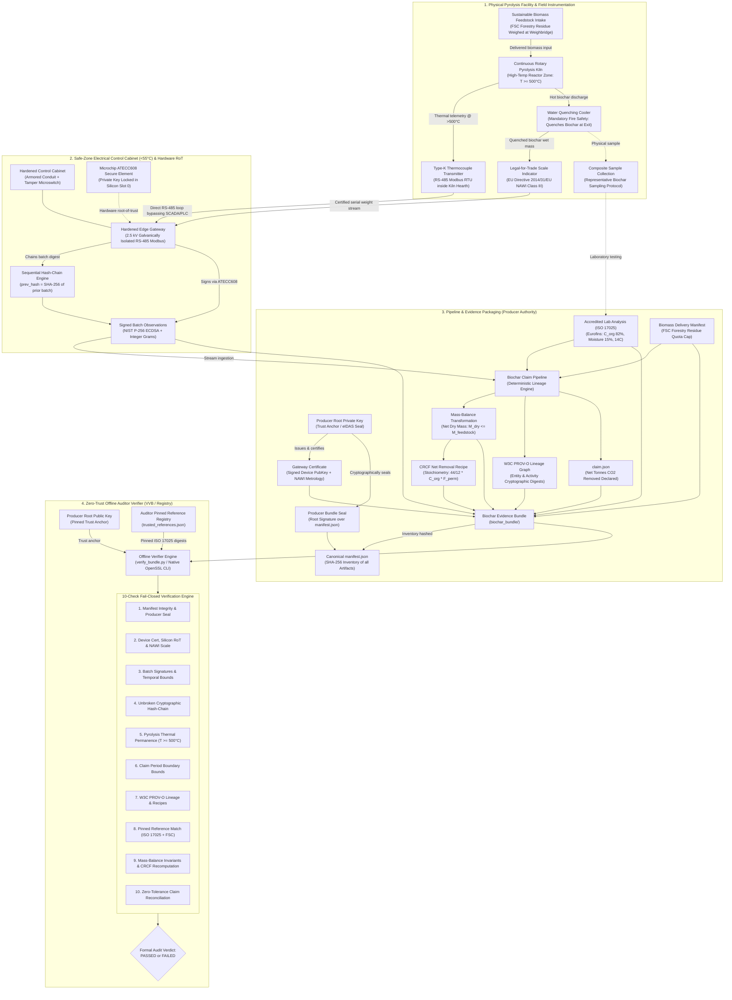
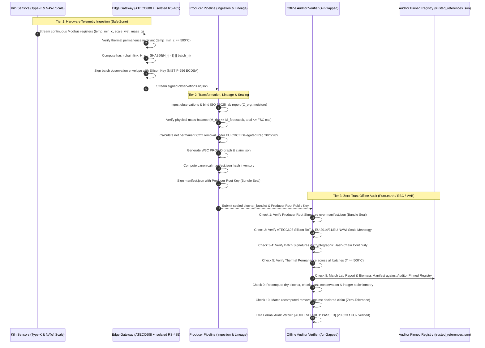
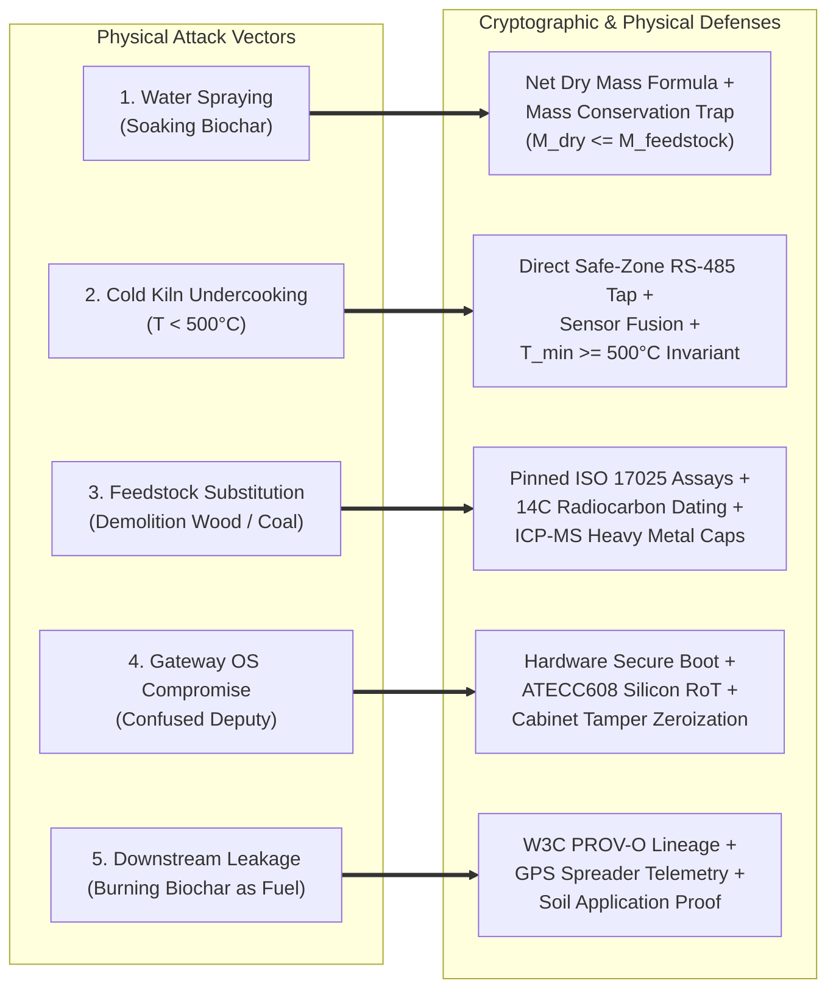
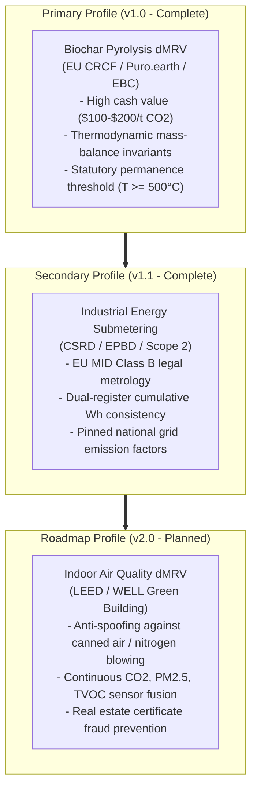

# Verifiable Telemetry (v1.2)

> **Open-Source Hardware Root-of-Trust & Local-First Cryptographic Provenance for Industrial Climate Telemetry (EU CRCF & CSRD)**

[](LICENSE)
[]()
[]()
[]()
[]()
[]()
[]()

---

## Executive Summary

Today, physical telemetry (industrial IoT) lacks an open, trustworthy internet architecture. Millions of edge sensors are funneled into proprietary cloud silos ("dark stacks"), unauthenticated SQL databases, and manual spreadsheets where operational telemetry can be silently altered, trimmed, or falsified before audit.

Nowhere is this trust crisis more acute than in high-durability carbon removals—such as industrial biochar pyrolysis certified under the **EU Carbon Removal Certification Framework (CRCF, Delegated Regulation (EU) 2026/285)**, **Puro.earth CORCs**, and the **European Biochar Certificate (EBC)**—and corporate ESG accounting (**CSRD Directive 2022/2464**). In durable carbon removal, each metric ton of permanent carbon removed commands **\$100–\$200 in direct market cash**. Yet validation and verification bodies (VVBs) must audit annual claims against easily manipulated spreadsheets, uncalibrated scale printouts, and unverified kiln logs. Without cryptographic binding, fraud vectors such as **water spraying (moisture inflation)**, **kiln thermal undercooking ($T < 500^\circ\text{C}$)**, **uncertified feedstock substitution**, and **period truncation** remain trivially undetectable.

**Verifiable Telemetry** restacks the physical-to-internet trust boundary with an open-source, local-first engine. A hardened edge gateway captures raw physical sensor telemetry (RS-485 Modbus RTU Type-K thermocouples and EU 2014/31/EU NAWI legal scales) directly at the wire, signing readings inside hardware secure elements (Microchip ATECC608 in Silicon Slot 0) into an unbroken cryptographic hash-chain. Self-contained W3C PROV-O evidence bundles allow independent auditors to verify physical origin, thermal permanence, mass conservation, and net removals **100% offline with zero cloud vendor lock-in**.

### Modular Dual-Profile Architecture
1. **Primary Profile (`biochar_pyrolysis`):** High-durability carbon removal under EU CRCF, Puro.earth, and EBC. Binds continuous Type-K thermocouple logs ($T \ge 500^\circ\text{C}$), legal-for-trade scale indicators (EU 2014/31/EU NAWI), accredited ISO 17025 lab reports ($C_{\text{org}}$, moisture, $^{14}\text{C}$), physical mass-balance invariants, and net tonnes $\text{CO}_2$ sequestered.
2. **Secondary Profile (`energy_submetering`):** Industrial electrical submetering under CSRD (Directive 2022/2464) and EPBD. Binds MID Class B electricity meters, dual-register deltas (integer cumulative Wh vs interval Wh), and pinned ISPRA grid emission factors.

### The Trust Boundary Philosophy
> *"We do not claim to solve all physical tampering in the universe. We make fraud require physical hardware tampering or multi-party collusion, instead of an unauthenticated database query or spreadsheet edit."*

---

## 3-Layer Security Architecture

### System Architecture & Data Flow (Biochar Pyrolysis dMRV)



### End-to-End Cryptographic Lifecycle



---

## The Regulatory and Standards Governance Ecosystem

Carbon credits for high-durability carbon removals cannot be self-issued or based on unverified operational claims. Legitimate producers must comply with a rigorous, multi-layered regulatory and statutory governance framework:

1. **The EU CRCF (Carbon Removals and Carbon Farming Regulation — Delegated Regulation (EU) 2026/285):**
   * **Statutory European Law:** The European Union's legally binding framework for permanent carbon removals.
   * **Thermal Permanence Mandate:** Legally defines permanent biochar as biomass pyrolyzed at a sustained minimum temperature of $T \ge 500^\circ\text{C}$ with an organic molar ratio of $\text{H/C}_{\text{org}} \le 0.70$, guaranteeing carbon sequestration durability exceeding several centuries to millennia.
   * **Net Life-Cycle Accounting:** Requires strict subtraction of all operational emissions ($E_{\text{process}}$, including kiln electricity, diesel for biomass harvesting/hauling, and water quenching pumping) from gross carbon content:
     $$E_{\text{net}} = E_{\text{gross}} - E_{\text{leakage}} - E_{\text{process}}$$
   * **Additionality & Baseline:** Requires audited proof that biomass harvesting does not deplete forest carbon stocks or violate EU RED III sustainability criteria.

2. **The ICVCM (Integrity Council for the Voluntary Carbon Market):**
   * **Core Carbon Principles (CCPs):** The independent governance body that benchmarks crediting methodologies.
   * **Four Pillars:** Mandates *Robust Quantification* (no scientific uncertainty inflation), *Permanence* (mandatory buffer pools and thermal permanence audits), *No Double Counting* (unique immutable serial numbers), and *Independent Third-Party Verification*.

3. **Major Registries and Certification Standards:**
   * **Puro.earth (Puro Standard):** Holds >70% of the commercial durable CDR market. Issues CO2 Removal Certificates (CORCs). Requires physical VVB audits of production kilns, digital inspection of continuous thermocouple records, biomass delivery manifests, and accredited ISO 17025 laboratory test certificates before any credit can be minted.
   * **European Biochar Certificate (EBC):** Defines certified feedstock positive lists (e.g. `EBC-1.1-FOREST` forestry residues), maximum limits for toxic contaminants (heavy metals, PAHs, dioxins), and certified agricultural applications.
   * **Isometric:** High-integrity durable carbon removal standard enforcing strict quantitative uncertainty bounds, continuous monitoring, and zero-tolerance reconciliation.

4. **Harmonized Statutory Legal Metrology:**
   * **EU Directive 2014/31/EU (NAWI):** Non-Automatic Weighing Instruments directive governing legal-for-trade weighing indicators (Class III accuracy) used for certified batch mass measurement.
   * **EU Directive 2014/32/EU (MID):** Measuring Instruments Directive governing Class B electricity submeters for industrial energy and Scope 2 GHG accounting.
   * **EU Directive 2022/2464/EU (CSRD) & EPBD:** Mandatory corporate sustainability disclosures and energy performance standards across the European Single Market.

---

## Physical-to-Digital Boundary & Fraud Defense Architecture

In industrial IoT and digital Measurement, Reporting, and Verification (dMRV), cryptographically securing data *after* it enters an edge gateway is necessary, but insufficient on its own. A truly trustworthy system must address the **physical-to-digital boundary**—the seam between physical plant operations and digital telemetry where real-world scams originate.

Below is an engineering analysis of how Verifiable Telemetry closes the five primary real-world fraud vulnerabilities:



### 1. The "Water Spraying" Scam & The Mass Conservation Trap

* **The Physical Reality:** Fresh biochar discharges from the pyrolysis kiln at $>500^\circ\text{C}$ and **must** be quenched with water immediately upon exiting to prevent spontaneous auto-ignition when exposed to atmospheric oxygen. Consequently, legal-for-trade scale indicators measure *wet* biochar mass ($M_{\text{wet}}$).
* **The Scam:** A dishonest operator hoses down the output pile with thousands of liters of excess water, hoping that the heavier scale reading translates into inflated metric tonnes of carbon removal credits.
* **The dMRV Defense:**
  1. **Strict Net Dry Mass Quantification:** Carbon credits are never awarded on scale weight. Credits are calculated strictly on **Net Dry Mass**:
     $$M_{\text{dry}} = \frac{M_{\text{wet}} \times (10,000 - \text{moisture\_bps})}{10,000}$$
  2. **Automatic Moisture Discounting:** When the operator drenches the biochar, composite samples sent to an accredited ISO 17025 laboratory (e.g. Eurofins) measure an elevated moisture percentage (e.g. 35.00%). This high moisture reading mathematically discounts the gross wet weight back to the exact true dry carbon weight. Water spraying is thus heavily penalized, not rewarded.
  3. **The Inescapable Mass Conservation Trap:** If the operator attempts to cheat the moisture formula by forging the lab report to declare artificially low moisture (e.g. declaring 10.00% moisture while the biochar is actually 35.00% water), the resulting calculated dry biochar mass will mathematically exceed the dry biomass input:
     $$M_{\text{dry}} > M_{\text{feedstock}}$$
     Because wood pyrolysis has a maximum theoretical yield of 25–35% biochar, creating dry biochar out of thin air violates the first law of thermodynamics ($M_{\text{out}} \le M_{\text{in}}$). Verifier **Check 9** programmatically enforces $M_{\text{dry}} \le M_{\text{feedstock}}$ and fails closed immediately (**Attack B1 Caught**).

### 2. The "Cold Kiln" Scam & Analog Sensor Spoofing ($T < 500^\circ\text{C}$)

* **The Physical Reality:** Silicon microchips (including secure elements like the ATECC608 and microcontrollers) cannot operate above $125^\circ\text{C}$ and will physically melt inside a $650^\circ\text{C}$ pyrolysis hearth. Therefore, the physical sensor inside the kiln must be an analog thermocouple (Type-K).
* **The Scam:** An operator operates the kiln at an energy-saving $350^\circ\text{C}$ (producing unstable charcoal that decomposes in agricultural soil within years rather than centuries), while manipulating software registers in the plant SCADA/PLC or placing a localized blowtorch on the thermocouple probe tip.
* **The dMRV Defense:**
  1. **Direct Safe-Zone Wire Tapping:** The edge gateway resides inside the locked electrical control cabinet in the safe zone ($<55^\circ\text{C}$). It taps the RS-485 Modbus RTU wire of the thermocouple transmitter directly, using 2.5 kV galvanically isolated transceivers. Telemetry is read directly at the hardware wire level, completely bypassing the plant SCADA/PLC software to prevent register overriding.
  2. **Continuous Thermal Permanence Invariant (Check 5):** The verifier inspects continuous minimum temperatures across every batch observation. Any batch where $T_{\min} < 500^\circ\text{C}$ causes an immediate, fail-closed audit rejection (**Attack B2 Caught**).
  3. **Multi-Zone Sensor Fusion:** To prevent localized probe spoofing (e.g., blowtorching a single thermocouple), the gateway reads a multi-point thermocouple array distributed across the kiln length (feed zone, reaction zone, discharge zone) and correlates temperature readings with induced draft (ID) fan current draw and differential hearth pressure. A manipulated probe disrupts aerodynamic-thermal correlation, triggering a cryptographic anomaly flag.

### 3. The "Garbage In" Problem: Feedstock Fraud (Demolition Wood / Coal Dust)

* **The Physical Reality:** Legal-for-trade scales weigh gravitational mass; they cannot determine molecular chemistry. A metric ton of fossil coal dust, tire crumbs, or toxic demolition lumber registers the exact same weight as a metric ton of certified sustainable forestry residues.
* **The Scam:** A producer blends cheap fossil coal dust or demolition wood treated with toxic preservatives into the biomass feed to artificially multiply carbon yield at minimal feedstock expense.
* **The dMRV Defense:**
  1. **Authoritative Reference Pinning (Check 8):** Every batch binds to an ISO 17025 accredited laboratory assay whose SHA-256 digest is pinned in the auditor's independent reference registry (`trusted_references.json`).
  2. **$^{14}\text{C}$ Radiocarbon Isotopic Dating:** Biogenic biomass absorbs atmospheric $^{14}\text{C}$ via photosynthesis during plant growth ($100\%\text{ Fraction Modern Carbon}$). Ancient fossil fuels (coal, lignite, petcoke) have zero $^{14}\text{C}$ due to radioactive decay over millions of years (half-life of $^{14}\text{C}$ is 5,730 years). Any fossil coal adulteration is immediately identified during ISO 17025 radiocarbon analysis.
  3. **ICP-MS Heavy Metal & Preservative Screening:** Demolition wood treated with Chromated Copper Arsenate (CCA) or creosote is caught by mandatory ISO 17025 ICP-MS screening ($<10\text{ mg/kg}$ As, $<50\text{ mg/kg}$ Cu, $<1\text{ mg/kg}$ Cd).
  4. **Cumulative Feedstock Quota Capping (Check 9):** Telemetry observations record the delivery note identifier (`delivery_fsc_wood_2026_09`). The verifier asserts that cumulative feedstock used across all verified batches cannot exceed the total verified biomass quota on the delivery manifest:
     $$\sum M_{\text{feedstock\_input\_g}} \le M_{\text{feedstock\_delivered\_total\_g}}$$
     This prevents "ghost-truck" double billing (**Attacks B4 & B8 Caught**).

### 4. The "Confused Deputy" Attack (Gateway OS Compromise)

* **The Physical Reality:** The Microchip ATECC608 secure element prevents private key extraction via physical side-channel resistance. However, the host processor (running Linux or RTOS) instructs the ATECC608 *what* payload to sign.
* **The Scam:** An adversary breaches the gateway operating system via an unpatched network service or malicious USB drive, instructing the ATECC608 to sign fabricated sensor readings.
* **The dMRV Defense:**
  1. **Hardware Secure Boot:** The host processor's bootloader verifies the cryptographic digital signature of the OS kernel and firmware against a ROM-fused manufacturer key prior to execution.
  2. **Physical Tamper Detection & Key Zeroization:** The edge gateway is housed inside a locked electrical cabinet equipped with chassis intrusion microswitches. If the cabinet door or gateway enclosure is opened without cryptographic maintenance authorization, the secure element immediately triggers hardware zeroization, permanently erasing its private keys.

### 5. Downstream Leakage: The End-Use Blind Spot (Combustion vs Soil Sequestration)

* **The Physical Reality:** If certified biochar is pyrolyzed cleanly at $>500^\circ\text{C}$ but subsequently sold to a third party and burned as barbecue charcoal or metallurgical fuel, all sequestered carbon is immediately released back into the atmosphere.
* **The Scam:** A producer legitimately mints a carbon removal credit and simultaneously sells the biochar into thermal combustion markets.
* **The dMRV Defense:**
  1. **W3C PROV-O Digital Lineage Extension:** The evidence bundle's cryptographic lineage graph (`provenance/provenance.json`) does not stop at the factory loading dock.
  2. **Verified Soil Application Manifests:** Final carbon credit retirement requires binding cryptographically signed delivery receipts and GPS-stamped tractor spreader telemetry proving that the biochar was blended into agricultural soils or permanent construction materials (e.g. concrete).

---

## Scope Boundary Matrix: What dMRV Enforces vs Physical Auditing

A rigorous cybersecurity architecture must honestly define the division of labor between digital cryptography, physical metrology, and institutional auditing:

| Fraud Vector | Can Software / Math Alone Solve It? | In-Scope dMRV Cryptographic Defense | Complementary Physical / Metrological Control |
|---|:---:|---|---|
| **Water Spraying (Moisture Fraud)** | No (cannot stop physical water hoses) | **Net Dry Mass Formula** ($M_{\text{dry}} = M_{\text{wet}} \times (1 - \text{moist})$) + **Mass Conservation Trap** ($M_{\text{dry}} \le M_{\text{feedstock}}$) | Composite sampling under ISO 17025 accredited laboratory protocol |
| **Cold Kiln Undercooking ($T < 500^\circ\text{C}$)** | Yes | **Check 5 Invariant:** Continuous $T_{\min} \ge 500^\circ\text{C}$ signed at source; fails closed | Direct Modbus RS-485 tap inside safe-zone cabinet + Multi-Zone Sensor Fusion |
| **Fossil Coal Dust Adulteration** | No (scales measure mass, not chemistry) | **Check 8 Pinned Reference Match:** Lab assay digest pinned in auditor registry | ISO 17025 $^{14}\text{C}$ radiocarbon dating (detects 0% modern carbon in fossil fuels) |
| **Toxic Demolition Wood (CCA Treated)** | No (scales measure mass, not chemistry) | **Check 8 & 9 Delivery Quota:** Pinned EBC positive list supplier + usage cap | ISO 17025 ICP-MS heavy metal screening (strict limits on As, Cu, Cr) |
| **Scale Drift / Cheap Fake Scales** | Yes | **Check 2 Metrological Pedigree:** EU Directive 2014/31/EU NAWI Class III certificate binding | Annual physical calibration by national metrology bodies (stamped lead seals) |
| **Dropping Failed / Cold Batches** | Yes | **Check 4 Hash-Chain Continuity:** Sequential `prev_hash` links prevent record dropping | Monotonic hardware sequence counters locked in ATECC608 silicon |
| **Post-Hoc Spreadsheet / DB Edits** | Yes | **Check 1 Bundle Seal:** Producer Root signature over canonical SHA-256 manifest | eIDAS Qualified Electronic Seal / enterprise PKI trust anchor |
| **Sensor Cable Disconnection / Spoofing** | Partial | **Direct Cabinet Tapping:** Bypasses SCADA software registers; 2.5 kV galvanic isolation | Armored conduit, locked cabinet, chassis intrusion tamper switches |
| **End-Use Combustion (BBQ Burning)** | No (factory cannot police customer usage) | **W3C PROV-O Graph:** Lineage tracking downstream to delivery manifest | GPS-tracked tractor spreader telemetry & verified soil application receipts |

### The "Collusion-Forcing" Security Thesis
> **Core Principle:** Verifiable Telemetry does not claim to replace physical reality. Instead, it alters the economic and operational attack surface:
> 
> * **Today:** An operator commits multi-million-dollar carbon fraud with **zero physical traces** by altering an Excel cell, modifying an unauthenticated SQL database row, or re-exporting a CSV.
> * **With Verifiable Telemetry:** Fraud is elevated to **criminal hardware tampering or multi-party institutional collusion**. To fraudulently mint a credit, the operator must physically break into a locked cabinet, defeat hardware secure boot, violate thermodynamic mass conservation, and bribe an independent ISO 17025 accredited testing laboratory (Eurofins) to falsify radiocarbon dating.

---

## Strategic Profile Selection: Why Biochar First, Energy Second, IAQ Third

This project deliberately organizes its dMRV profiles into a prioritized, multi-phase roadmap based on market urgency, financial stakes, and thermodynamic verifiability:



1. **Primary Profile: Biochar Pyrolysis (`biochar_pyrolysis` — v1.0, Complete):**
   * **Highest Financial & Environmental Stakes:** High-durability carbon removal credits trade at **\$100–\$200 per metric ton of $\text{CO}_2$**. A medium-sized facility producing 5,000 tonnes of biochar per year moves hundreds of thousands of dollars in carbon finance, creating enormous financial incentives for moisture inflation, undercooking, or feedstock adulteration.
   * **Rigid Physical Laws:** Pyrolysis is governed by inescapable thermodynamic invariants ($M_{\text{dry}} \le M_{\text{feedstock}}$) and statutory permanence definitions ($T \ge 500^\circ\text{C}$), making it the ultimate proving ground for cryptographic dMRV.

2. **Secondary Profile: Industrial Energy Submetering (`energy_submetering` — v1.1, Complete):**
   * **Statutory ESG Compliance:** Driven by the EU Corporate Sustainability Reporting Directive (CSRD) and Energy Performance of Buildings Directive (EPBD).
   * **Dual-Register Invariants:** Enforces mathematical agreement between high-frequency interval readings and immutable cumulative registers ($\Delta \text{cumulative\_wh} == \text{interval\_wh}$) anchored to EU MID Class B meters.

3. **Roadmap Profile: Indoor Air Quality (`indoor_air_quality` — v2.0, Planned):**
   * **The Emerging Real-Estate Fraud Vector:** Commercial properties frequently manipulate indoor air quality (IAQ) sensors to achieve prestigious LEED or WELL green building certifications (e.g. blowing canned air or pure nitrogen on $\text{CO}_2$ and PM2.5 sensors during compliance audits to simulate superior ventilation).
   * **Sensor Fusion Defense:** The cryptographic engine will be extended to correlate indoor $\text{CO}_2$, PM2.5, VOCs, HVAC fan speed, and outdoor air conditions to detect localized gas spraying and sensor isolation.

---

## Key Architectural Features

1. **Zero External Dependencies:** Built entirely with Python 3 standard library and native POSIX OpenSSL CLI (`openssl dgst -sha256`). Runs in air-gapped auditor enclaves without `pip install`.
2. **Sequential Cryptographic Hash-Chains:** Each reading embeds `prev_hash`, preventing head/tail truncation, record reordering, and telemetry splicing.
3. **Statutory Thermodynamic & Process Invariants:** Enforces physical mass conservation ($M_{\text{dry}} \le M_{\text{feedstock}}$), thermal permanence ($T_{\min} \ge 500^\circ\text{C}$), and dual-register energy deltas ($\Delta \text{cumulative\_wh} == \text{interval\_wh}$).
4. **Metrological Pedigree Binding:** Cryptographically binds sensor model, NAWI 2014/31/EU / MID 2014/32/EU accuracy class, and factory calibration validity into the signed device certificate.
5. **Auditor-Pinned Reference Data:** Independent verification against pinned registry digests (`trusted_references.json`), neutralizing insider emission factor or laboratory assay manipulation.
6. **RFC 8785 Deterministic Canonicalization:** Strict integer accounting (grams, degrees Celsius, basis points, Watt-hours) eliminates cross-platform floating-point drift between Python and Rust.
7. **W3C PROV-O Cryptographic Lineage:** Unbroken provenance graph recording entities, activities, and cryptographic transformations from raw sensor telemetry to final registered claims.

---

## Quickstart Guide

### 1. Prerequisites
- Python 3.9+
- OpenSSL 3.x (native on macOS / Linux)
- Zero third-party pip dependencies required.

### 2. Primary Profile: Biochar Pyrolysis dMRV (EU CRCF / Puro.earth / EBC)

```bash
# Step 1: Simulate edge gateway tapping Type-K thermocouple + certified scale indicator (NAWI)
python3 src/device_simulator/mock_biochar_edge.py

# Step 2: Ingest telemetry stream, bind ISO 17025 lab report + FSC biomass manifest, and seal bundle
python3 src/pipeline/biochar_claim_generator.py

# Step 3: Run the independent zero-trust auditor verifier (10 fail-closed checks)
python3 src/verifier/verify_bundle.py biochar_bundle/ --company-key producer_root_public_key.pem
```

Expected biochar verifier output:
```text
======================================================================
 Independent Offline Verifier — Zero-Trust Biochar dMRV Audit (v1.2)
 Specification: 02_protocol/evidence_bundle_spec.md (biochar_pyrolysis)
 Standards: EU CRCF Delegated Regulation 2026/285 | Puro.earth | EBC
======================================================================
[*] Target Claim Bundle : biochar_bundle/
[*] Trust Anchor (Root) : producer_root_public_key.pem
----------------------------------------------------------------------
[Check 1/10] Manifest Integrity & Producer Bundle Seal : [PASSED]
[Check 2/10] Device Certificate & Scale Metrology (NAWI): [PASSED]
[Check 3/10] Batch Signatures & Temporal Bounds (ECDSA) : [PASSED] (5 batches)
[Check 4/10] Cryptographic Hash-Chain Continuity         : [PASSED]
[Check 5/10] Pyrolysis Thermal Permanence (T >= 500°C)  : [PASSED]
[Check 6/10] Claim Batch Boundary Bounds Enforcement    : [PASSED]
[Check 7/10] Transformation & W3C PROV-O Lineage Graph  : [PASSED]
[Check 8/10] Authoritative Reference Registry Pinning   : [PASSED]
[Check 9/10] Mass-Balance Invariants & CRCF Recomputation: [PASSED]
[Check 10/10] Numeric Claim Reconciliation (Zero-Tol): [PASSED]
----------------------------------------------------------------------
 FORMAL AUDIT VERIFICATION SUMMARY (EU CRCF / PURO.EARTH)
----------------------------------------------------------------------
  * Batches Ingested          : 5 batches (Unbroken hash-chain)
  * Thermal Permanence        : Confirmed (All batches >= 500°C)
  * Mass Balance Proof        : Net Dry Biochar = 8.500 tonnes
  * Net Carbon Sequestered    : 20.523166 t CO2 (20523166 g)
----------------------------------------------------------------------
[AUDIT VERDICT: PASSED]
  Status: Declared origin verified. Permanence verified. Lineage verified.
  All 10 specification checks passed without exception.
======================================================================
```

### 3. Secondary Profile: Industrial Energy Submetering (CSRD / EPBD)

```bash
# Step 1: Simulate electrical submeter edge gateway
python3 src/device_simulator/mock_edge.py

# Step 2: Transform cumulative Wh, link ISPRA grid factor, and seal evidence bundle
python3 src/pipeline/claim_generator.py

# Step 3: Run the independent zero-trust auditor verifier
python3 src/verifier/verify_bundle.py claim_bundle/ --company-key company_root_public_key.pem
```

---

## Adversarial Benchmark & Attack Suites

The pipeline includes comprehensive adversarial test suites programmatically asserting fail-closed rejection of **25 distinct fraud vectors**:

```bash
# Run biochar pyrolysis dMRV adversary suite (10 attack vectors)
python3 src/attacks/biochar_attacks.py

# Run outsider adversary suite (10 attack vectors)
python3 src/attacks/outsider_attacks.py

# Run insider corporate fraud suite (5 attack vectors)
python3 src/attacks/insider_fraud_suite.py
```

### Biochar dMRV Adversary Matrix (10/10 Caught)
| ID | Attack Vector | Verifier Defense | Verdict |
|---|---|---|:---:|
| **B1** | Water Spraying / Moisture Inflation Fraud | Physical mass-balance conservation invariant ($M_{\text{dry}} \le M_{\text{feedstock}}$) | ❌ Caught |
| **B2** | Thermal Undercooking ($T_{\min} < 500^\circ\text{C}$) | EU CRCF statutory thermal permanence invariant | ❌ Caught |
| **B3** | Counterfeit Lab Report (ISO 17025 Violation) | Auditor pinned reference registry validation | ❌ Caught |
| **B4** | Feedstock Cap Exhaustion (Used > Quota) | Cumulative biomass delivery manifest cap enforcement | ❌ Caught |
| **B5** | Dropped Batch / Selective Omission | Sequential cryptographic hash-chain continuity (`prev_hash`) | ❌ Caught |
| **B6** | Non-Certified Scale Indicator | EU Directive 2014/31/EU NAWI legal metrology check | ❌ Caught |
| **B7** | Software Key without Silicon Attestation | Microchip ATECC608 hardware attestation verification | ❌ Caught |
| **B8** | Uncertified Biomass Source | EBC positive list & pinned manifest registry verification | ❌ Caught |
| **B9** | Numeric Claim Inflation | Recomputed stoichiometry vs declared claim zero-tolerance match | ❌ Caught |
| **B10** | Revoked Kiln Gateway Rejection | Pinned `--revoked` device list enforcement | ❌ Caught |

### Outsider Adversary Matrix (10/10 Caught)
| ID | Attack Vector | Verifier Defense | Verdict |
|---|---|---|:---:|
| **O1** | Falsified Reading Value | NIST P-256 ECDSA observation signature failure | ❌ Caught |
| **O2** | Rogue Uncertified Public Key | Company root certificate chain validation failure | ❌ Caught |
| **O3** | Dropped Observation Record | Monotonic sequence check and hash-chain failure | ❌ Caught |
| **O4** | Duplicate Replay Record | Sequence uniqueness check | ❌ Caught |
| **O5** | Envelope Device ID Mismatch | Device ID consistency check vs certificate | ❌ Caught |
| **O6** | Expired / Future Timestamp | Temporal window check vs certificate validity | ❌ Caught |
| **O7** | Re-hashed Manifest Bypass | Company root bundle seal signature failure | ❌ Caught |
| **O8** | Path Traversal Injection (`../../`) | Strict relative path schema validation | ❌ Caught |
| **O9** | Unmanifested File Injection | Zero-tolerance bundle inventory check | ❌ Caught |
| **O10** | Revoked Gateway Rejection | Pinned `--revoked` device list enforcement | ❌ Caught |

### Insider Corporate Fraud Matrix (5/5 Caught)
| ID | Attack Vector | Verifier Defense | Verdict |
|---|---|---|:---:|
| **I1** | Emission Factor Greenwashing + Reseal | Auditor pinned reference registry check | ❌ Caught |
| **I2** | Dual-Register Interval Shaving | Meter register delta consistency check ($\Delta \text{cum} == \text{int}$) | ❌ Caught |
| **I3** | Period Head/Tail Truncation | Claim declared period boundaries vs audit mandate | ❌ Caught |
| **I4** | Unattested Software Simulator Key | Silicon hardware attestation chain validation | ❌ Caught |
| **I5** | Telemetry Splicing & Re-chaining | Sequential cryptographic hash continuity | ❌ Caught |

---

## Cross-Language Conformance Test Vectors

To support Milestone 3 (Rust rewrite of the verifier engine), this repository freezes immutable golden test vectors:
- **Biochar Pyrolysis:** [`04_experiments/golden_test_vector_biochar/`](04_experiments/golden_test_vector_biochar/)
- **Energy Submetering:** [`04_experiments/golden_test_vector/`](04_experiments/golden_test_vector/)

Verify the biochar golden vector:
```bash
python3 src/verifier/verify_bundle.py \
  04_experiments/golden_test_vector_biochar/biochar_bundle/ \
  --company-key 04_experiments/golden_test_vector_biochar/producer_root_public_key.pem \
  --json
```

---

## Repository Map

```text
├── 00_project/             # Roadmap, decision registers, NLnet application draft & trackers
├── 01_literature/          # Academic literature matrix, search protocols, and gap analysis
├── 02_protocol/            # Evidence Bundle Specification v1.2 & threat boundaries
├── 03_system/              # System architecture docs and formal threat model
├── 04_experiments/         # Golden test vectors (Biochar & Energy) and experiment registry
├── biochar_bundle/         # Verified Biochar dMRV evidence bundle (EU CRCF / Puro)
├── claim_bundle/           # Verified Energy Submetering evidence bundle (CSRD)
├── src/
│   ├── device_simulator/   # Edge simulators: mock_biochar_edge.py & mock_edge.py
│   ├── pipeline/           # Lineage generators: biochar_claim_generator.py & claim_generator.py
│   ├── verifier/           # Modular 10-check zero-trust verifier CLI & trusted registry
│   └── attacks/            # Biochar (10/10), outsider (10/10), and insider (5/5) test suites
├── LICENSE                 # Apache 2.0 Open-Source License
└── README.md               # Project documentation
```

---

## Roadmap & Milestones (NLnet Restack)

- [x] **Milestone 1:** Specification Freeze, Canonical RFC 8785 Schemas & Adversarial Threat Model (v1.2 Complete in local prototype)
- [ ] **Milestone 2:** Hardware Root-of-Trust & Isolated Edge Ingestion Gateway (ATECC608 I2C driver & isolated RS-485 reader daemon)
- [ ] **Milestone 3:** Zero-Dependency Offline Verifier Engine & Cross-Language Determinism (Rust verifier binary & air-gapped CLI)
- [ ] **Milestone 4:** Reference Hardware Testbench, Adversarial Benchmark & Public Release (Physical bench, open-hardware wiring guides & Apache 2.0 release)

---

## License

This project is licensed under the **Apache License 2.0**. See the [LICENSE](LICENSE) file for details.
