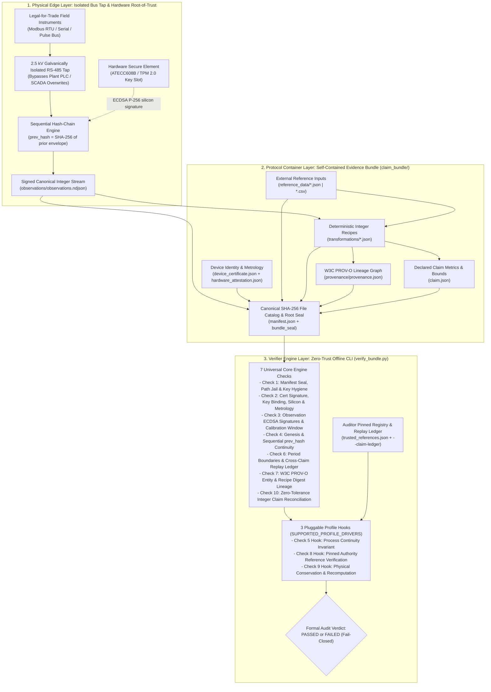
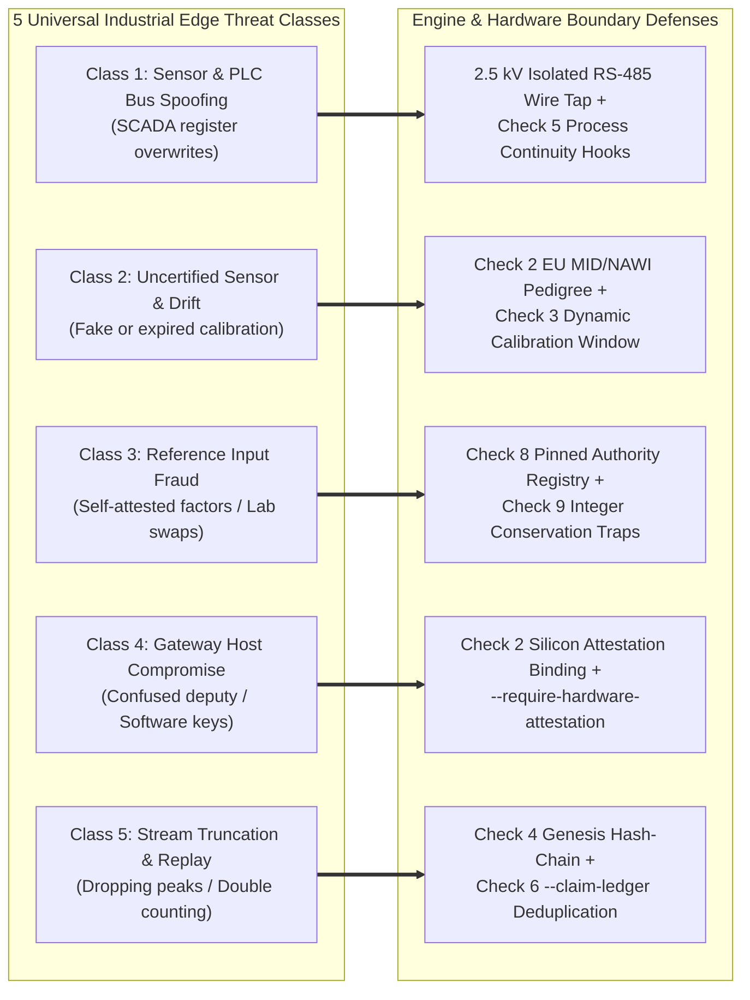

# Verifiable Telemetry Engine (v1.2)

> **Universal, Pluggable Open-Source Hardware Root-of-Trust & Offline Cryptographic Verifier for Industrial IoT Telemetry**

[](LICENSE)
[]()
[]()
[]()
[]()
[]()
[]()

---

## 1. Executive Summary: Building the Engine, Not the Car

Modern industrial telemetry lacks an open, trustworthy physical-to-digital foundation. Across energy grids, manufacturing plants, heat networks, water treatment facilities, and environmental compliance sites, physical edge instruments (submeters, weighing scales, flow meters, thermocouples) feed raw readings into operator-controlled PLC/SCADA servers, mutable SQL databases, and proprietary cloud silos ("dark stacks"). Before an external auditor or regulator ever inspects a compliance report, intervals can be shaved, anomalous batches omitted, calibration windows ignored, or conversion factors cherry-picked without leaving any cryptographic trace.

Standard cybersecurity tools do not solve this problem: **TLS only encrypts data in transit against external eavesdroppers, whereas in industrial compliance and regulatory auditing, the facility operator has physical and root administrative access to the local network and database.**

**Verifiable Telemetry** builds the **universal open-source cryptographic engine** for physical telemetry—not a single-vertical SaaS application ("the engine, not the car"):
* **At the Physical Edge Boundary:** A hardened edge gateway taps legal-for-trade field instruments directly over 2.5 kV galvanically isolated RS-485/serial links (ahead of operator PLC/SCADA software), formats readings as deterministic scaled integers (RFC 8785), chains every record to the SHA-256 hash of its predecessor (`prev_hash`), and signs each envelope inside a hardware Secure Element (`Microchip ATECC608B` or `TPM 2.0`).
* **In the Evidence Container (`claim_bundle/`):** Telemetry streams, device certificates, legal metrology calibration windows, pinned external reference digests, and deterministic integer transformation recipes are bound into a self-contained **W3C PROV-O** evidence bundle sealed by the Producer Root Key.
* **At the Independent Verifier (`verify_bundle.py`):** An air-gapped auditor, conformity assessment body (CAB/VVB), or regulator runs a zero-dependency CLI engine (Python 3 stdlib + POSIX OpenSSL, with a standalone Rust port in Milestone 3) that executes **7 universal cryptographic & structural engine checks** plus **3 pluggable domain invariant hooks**—verifying physical origin, stream continuity, and conservation laws **100% offline with zero trust in the reporting operator**.

---

## 2. Universal Engine Architecture (7 Core Checks + 3 Pluggable Hooks)

The engine cleanly separates **domain-agnostic cryptographic verification** (7 Core Engine Checks) from **domain-specific physical conservation rules** (3 Pluggable Profile Hooks dispatched via `SUPPORTED_PROFILE_DRIVERS`).



### The 10-Check Fail-Closed Verifier State Machine

| Check # | Engine Layer | Verification Stage | Universal Engine Enforcement / Plugin Hook Contract |
|:---:|:---:|---|---|
| **1** | **Core Engine** | **Manifest Seal & Key Hygiene** | Verifies Producer Root ECDSA P-256 seal on `manifest.json`; recomputes SHA-256 of every file; blocks path traversal (`../../`) and unmanifested files; rejects any bundled private keys (`*private*`, `*.key`). |
| **2** | **Core Engine** | **Device Cert, Silicon & Metrology** | Verifies Root signature on `device_certificate.json`; binds `device/public_key.pem` and derived `device_id`; verifies `ATECC608B` attestation key hash (rejecting software stubs via `--require-hardware-attestation`); validates legal metrology standard (`EU_MID_2014_32_EU` / `EU_Directive_2014_31_EU_NAWI`). |
| **3** | **Core Engine** | **Observation Signatures & Window** | Verifies NIST P-256 signature on every observation record; dynamically enforces that every record timestamp falls inside both certificate validity and sensor `calibration_valid_until`. |
| **4** | **Core Engine** | **Hash-Chain Continuity** | Verifies genesis zero-hash (`sequence == 1`) and unbroken `prev_hash[i] == SHA-256(canonical_json(record[i-1]))`, sequence `+1`, unique IDs, and monotonic timestamps. |
| **5** | **Profile Hook** | **Process Continuity Invariant** | **Pluggable Hook (`check5_hook`):** Enforces per-record physical continuity (e.g., dual-register meter delta `Δ cumulative_wh == interval_wh` or continuous minimum temperature $T_{\min} \ge 500^\circ\text{C}$). |
| **6** | **Core Engine** | **Claim Bounds & Replay Ledger** | Matches stream `first_sequence`, `last_sequence`, record/batch count, and `terminal_hash` to `claim.json`. Enforces cross-claim deduplication via `--claim-ledger` to block double-counting. |
| **7** | **Core Engine** | **W3C PROV-O Lineage** | Validates `provenance/provenance.json` entity SHA-256 digests and transformation recipe bindings. |
| **8** | **Profile Hook** | **Pinned Authority Reference** | **Pluggable Hook (`check8_hook`):** Verifies SHA-256 digests and statutory bounds of external reference files in `reference_data/` against the auditor's out-of-band `trusted_references.json`. |
| **9** | **Profile Hook** | **Conservation & Recomputation** | **Pluggable Hook (`check9_hook`):** Evaluates domain conservation inequalities in scaled integer arithmetic (mass balance, energy balance, conversion yield ceilings, delivery caps) and recomputes claim metrics. |
| **10** | **Core Engine** | **Zero-Tolerance Reconciliation** | Asserts exact bit-for-bit equality between Check 9 recomputed integer metrics and declared values in `claim.json`. |

---

## 3. Pluggable Profile Architecture: How Any Domain Plugs Into the Engine

Any industrial sector—such as green hydrogen electrolysis, district heating, EV fleet charging, industrial water treatment, electrical submetering, or carbon dioxide removal—can plug into the core engine without modifying the cryptographic container or core verifier checks.

A domain profile driver consists of **three declarative components**:
1. **Canonical Integer Observation Schema (`observations/observations.ndjson`):** Defines the signed integer telemetry fields (`Wh`, `g`, `°C`, `bps` where $10{,}000\text{ bps} = 100.00\%$), eliminating IEEE 754 floating-point drift across Python, Rust, and C.
2. **Pinned Authority Registry Entry (`src/verifier/trusted_references.json`):** Pins out-of-band SHA-256 digests for authoritative reference datasets (e.g., national grid factors, ISO 17025 lab assays, delivery manifests) and statutory `methodology_parameters`.
3. **Profile Driver Registration (`SUPPORTED_PROFILE_DRIVERS` in `verify_bundle.py`):** Maps the profile identifier in `claim.json` to its Check 5, Check 8, and Check 9 hooks.

Inspect the registered profile drivers directly via the CLI:
```bash
python3 src/verifier/verify_bundle.py --list-profiles
```
```text
======================================================================
 Universal Verifiable Telemetry Engine — Registered Profile Drivers
======================================================================
[*] Profile ID  : energy_submetering
    Description : Industrial Electrical Submetering & Scope 2 GHG (EU MID 2014/32/EU & CSRD)
    Metrology   : EU_MID_2014_32_EU (Class A/B/C, EN 50470-3)
    Check 5 Hook: Dual-register cumulative vs. interval Wh delta continuity
    Check 8 Hook: Pinned national grid emission factor SHA-256 registry match
    Check 9 Hook: Deterministic integer Wh summation & Scope 2 kg CO2e recomputation
----------------------------------------------------------------------
[*] Profile ID  : biochar_pyrolysis
    Description : High-Durability Pyrolysis Mass-Balance & Thermal Verification (EU NAWI 2014/31/EU & CRCF)
    Metrology   : EU_Directive_2014_31_EU_NAWI (Class I/II/III) + Type-K Thermocouple
    Check 5 Hook: Continuous thermal floor invariant (temp_min_c >= min_pyrolysis_temp_c)
    Check 8 Hook: Pinned ISO 17025 lab report & feedstock manifest SHA-256 registry match
    Check 9 Hook: 6-part mass-balance conservation (dry <= input, max dry yield bps, delivery cap)
----------------------------------------------------------------------
```

---

## 4. Universal Physical-to-Digital Edge Threat Model

Securing telemetry *after* it enters a gateway is insufficient if an insider can manipulate sensors or software registers *before* signing. The engine and its hardware deployment guidance address **five universal edge threat classes**:



| Threat Class | Attack Vector | In-Scope Engine & Cryptographic Defense | Complementary Physical / Institutional Control |
|---|---|---|---|
| **1. Bus Spoofing ("Last Foot")** | Overwriting PLC/SCADA registers or spoofing single probes | **Check 5 Continuity Hook:** Enforces dual-register delta (`Δ cumulative_wh == interval_wh`) or thermal floor ($T_{\min} \ge 500^\circ\text{C}$) | Direct 2.5 kV galvanically isolated RS-485 tap ahead of PLC + multi-sensor correlation |
| **2. Metrology Drift** | Swapping in uncertified sensors or operating past calibration expiry | **Checks 2 & 3 Metrology Binding:** Validates EU MID / NAWI standard and enforces `timestamp <= calibration_valid_until` | Physical lead seals and periodic calibration by accredited national metrology institutes |
| **3. Reference Fraud ("Garbage In")** | Swapping emission factors, inflating moisture weight, or faking assays | **Check 8 Pinned Registry & Check 9 Conservation:** Out-of-band SHA-256 digest pinning + integer conservation inequalities | ISO 17025 accredited lab assays ($^{14}\text{C}$ dating, moisture, ICP-MS) & official grid registries |
| **4. Confused Deputy** | Signing synthetic data with software keys or compromised gateway OS | **Check 2 Silicon Attestation:** Verifies `attested_public_key_sha256` and rejects stubs via `--require-hardware-attestation` | ATECC608B / TPM 2.0 hardware key isolation, Secure Boot, cabinet tamper zeroization |
| **5. Truncation & Replay** | Omitting peak intervals or re-submitting valid bundles across audits | **Checks 4 & 6 Continuity & Ledger:** Unbroken `prev_hash` chain + `--claim-ledger` cross-claim deduplication | External RFC 3161 timestamping / public transparency log anchoring |

### The "Collusion-Forcing" Security Thesis
> *"We do not claim that cryptography alone replaces physical reality. Instead, the engine eliminates costless digital fraud—forcing any prospective attacker out of mutable spreadsheets and SQL databases and into high-risk physical hardware tampering or multi-party institutional collusion across hardware manufacturers, national metrology institutes, and ISO 17025 accredited laboratories."*

---

## 5. Reference Profile Drivers (Proving Grounds)

To prove that the core engine is genuinely domain-agnostic, the repository ships with **two reference profile drivers** spanning the two primary physical measurement paradigms in industrial telemetry:

1. **Reference Driver 1: `energy_submetering` (Continuous Linear Flow)**
   * **Physical Paradigm:** Continuous, monotonic electrical energy accumulation ($E_{\text{cum}}[i] - E_{\text{cum}}[i-1] = E_{\text{int}}[i]$).
   * **Standards & Metrology:** EU Measuring Instruments Directive (**2014/32/EU MID Class B**, EN 50470-3) and EU **CSRD** Scope 2 accounting.
   * **Engine Hooks Validated:** Dual-register delta conservation (`Check 5`), pinned national grid emission factor digests (`Check 8`), and exact integer Watt-hour summation (`Check 9`).
2. **Reference Driver 2: `biochar_pyrolysis` (Non-Linear Mass & Thermal Transformation)**
   * **Physical Paradigm:** Multi-sensor batch material conversion involving moisture evaporation, thermal thresholds, and stoichiometric transformation.
   * **Standards & Metrology:** EU Non-Automatic Weighing Instruments Directive (**2014/31/EU NAWI Class III**), Type-K thermocouple arrays, ISO 17025 chemical assays, and **EU CRCF** (Regulation (EU) 2024/3012 / Delegated Regulation (EU) 2026/285).
   * **Engine Hooks Validated:** Continuous thermal floor $T_{\min} \ge 500^\circ\text{C}$ (`Check 5`), pinned ISO 17025 lab report and feedstock delivery digests (`Check 8`), and 6-part first-law mass conservation ($M_{\text{dry}, i} \le M_{\text{feedstock}, i}$, $\le 40.00\%$ dry yield ceiling, cumulative delivery cap, and integer basis-point stoichiometry in `Check 9`).

---

## 6. Quickstart Guide

### Prerequisites
- Python 3.9+ and OpenSSL 3.x (standard on macOS and Linux)
- **Zero third-party pip dependencies**

### Run Reference Driver 1: `energy_submetering` (Continuous Linear Flow)
```bash
# 1. Simulate EU MID Class B submeter gateway (hardware attestation + prev_hash signing)
python3 src/device_simulator/mock_edge.py

# 2. Package energy observations, W3C PROV-O lineage, and root-sealed manifest
python3 src/pipeline/claim_generator.py

# 3. Verify bundle offline (7 Core Engine Checks + 3 Energy Profile Hooks)
python3 src/verifier/verify_bundle.py claim_bundle/ --company-key company_root_public_key.pem
```

### Run Reference Driver 2: `biochar_pyrolysis` (Non-Linear Mass & Thermal Transformation)
```bash
# 1. Simulate EU NAWI Class III scale + Type-K thermocouple gateway
python3 src/device_simulator/mock_biochar_edge.py

# 2. Package batch observations, ISO 17025 lab assay, mass-balance recipes, and root seal
python3 src/pipeline/biochar_claim_generator.py

# 3. Verify bundle offline (7 Core Engine Checks + 3 Pyrolysis Profile Hooks)
python3 src/verifier/verify_bundle.py biochar_bundle/ --company-key producer_root_public_key.pem
```

---

## 7. Adversarial Benchmark & Security Regression Suites (33/33 Caught)

The engine is validated by **33 automated adversarial tests** plus a **6-exploit security re-audit regression harness (`P1–P6`)**, proving fail-closed rejection across outsider, insider, and multi-sensor physical attack vectors:

```bash
# 1. Run Core Engine Outsider Adversary Suite (11 attack vectors: O1–O11)
python3 src/attacks/outsider_attacks.py

# 2. Run Core & Linear Flow Insider Fraud Suite (5 attack vectors: I1–I5)
python3 src/attacks/insider_fraud_suite.py

# 3. Run Multi-Sensor Non-Linear Transformation Stress Suite (17 attack vectors: B1–B17)
python3 src/attacks/biochar_attacks.py

# 4. Run Security Re-Audit Regression Harness (6 PoC exploit regressions: P1–P6)
python3 04_experiments/security_reaudit/poc_exploits.py
```

### 7.1 Core Engine Outsider Adversary Matrix (`O1–O11` — 11/11 Caught)
| ID | Attack Vector | Core Engine Defense | Check | Verdict |
|:---:|---|---|:---:|:---:|
| **O1** | Falsified Telemetry Value | NIST P-256 ECDSA observation signature failure | Check 3 | ❌ Caught |
| **O2** | Rogue Uncertified Public Key | Producer Root certificate signature & key-binding failure | Check 2 | ❌ Caught |
| **O3** | Dropped Middle Observation | Monotonic sequence (`+1`) and `prev_hash` chain failure | Check 4 & 5 | ❌ Caught |
| **O4** | Duplicate Replay Observation | Sequence monotonicity and duplicate ID detection | Check 4 & 5 | ❌ Caught |
| **O5** | Envelope Device ID Spoofing | Public key SHA-256 fingerprint mismatch vs certified `device_id` | Check 2 & 3 | ❌ Caught |
| **O6** | Out-of-Bounds Timestamp | Temporal window check vs certificate `valid_from` / `valid_until` | Check 3 | ❌ Caught |
| **O7** | Re-Hashed Manifest Bypass | Producer Root Bundle Seal ECDSA verification failure | Check 1 | ❌ Caught |
| **O8** | Path Traversal Injection (`../../`) | Strict relative path normalization and bundle root jail | Check 1 | ❌ Caught |
| **O9** | Unmanifested File Injection | Bidirectional filesystem-to-manifest inventory check | Check 1 | ❌ Caught |
| **O10** | Revoked Gateway Key | Pinned `--revoked` device revocation list enforcement | Check 2 | ❌ Caught |
| **O11** | Private Key Material in Bundle | Zero-tolerance private key scanner across disk and manifest | Check 1 | ❌ Caught |

### 7.2 Core & Linear Flow Insider Fraud Matrix (`I1–I5` — 5/5 Caught)
| ID | Attack Vector | Engine & Profile Hook Defense | Check | Verdict |
|:---:|---|---|:---:|:---:|
| **I1** | Reference Factor Greenwashing + Reseal | Pinned Authority Registry SHA-256 digest check (`trusted_references.json`) | Check 8 | ❌ Caught |
| **I2** | Dual-Register Interval Shaving | Process Continuity Hook: `Δ cumulative_wh == interval_wh` | Check 5 | ❌ Caught |
| **I3** | Period Head/Tail Truncation | Claim declared sequence & period boundary enforcement | Check 6 | ❌ Caught |
| **I4** | Unattested Software Simulator Key | Hardware attestation public-key SHA-256 binding check | Check 2 | ❌ Caught |
| **I5** | Telemetry Splicing Across Shutdowns | Sequential cryptographic `prev_hash` chain continuity | Check 4 | ❌ Caught |

### 7.3 Multi-Sensor Non-Linear Transformation Stress Matrix (`B1–B17` — 17/17 Caught)
| ID | Attack Vector | Engine & Profile Hook Defense | Check | Verdict |
|:---:|---|---|:---:|:---:|
| **B1** | Moisture Weight Inflation Fraud | Conservation Hook: $M_{\text{dry}} \le M_{\text{feedstock}}$ violation | Check 9 | ❌ Caught |
| **B2** | Thermal Floor Violation ($T_{\min} < 500^\circ\text{C}$) | Process Continuity Hook: continuous $T_{\min} \ge 500^\circ\text{C}$ | Check 5 | ❌ Caught |
| **B3** | Unpinned / Forged Lab Assay | Reference Hook: ISO 17025 lab report SHA-256 digest mismatch | Check 8 | ❌ Caught |
| **B4** | Input Delivery Quota Exhaustion | Conservation Hook: cumulative input $\le$ delivered manifest cap | Check 9 | ❌ Caught |
| **B5** | Silent Batch Omission | Core Engine: sequential `prev_hash` chain break | Check 4 | ❌ Caught |
| **B6** | Non-Metrological Weighing Scale | Core Engine: EU Directive 2014/31/EU NAWI Class I–III check | Check 2 | ❌ Caught |
| **B7** | Tampered Silicon Attestation Hash | Core Engine: `attested_public_key_sha256` binding failure | Check 2 | ❌ Caught |
| **B8** | Uncertified Input Material Code | Reference Hook: positive list & pinned manifest digest check | Check 8 | ❌ Caught |
| **B9** | Declared Claim Metric Inflation | Core Engine: Check 10 zero-tolerance integer recomputation mismatch | Check 10 | ❌ Caught |
| **B10** | Revoked Gateway Submission | Core Engine: `--revoked` device list enforcement | Check 2 | ❌ Caught |
| **B11** | Private Key File Inside Bundle | Core Engine: Check 1 zero-tolerance private key hygiene failure | Check 1 | ❌ Caught |
| **B12** | Unbound Software Device Key | Core Engine: Check 2 `cert_body.device_public_key` & ID binding | Check 2 | ❌ Caught |
| **B13** | Expired Sensor Calibration Window | Core Engine: Check 3 dynamic `timestamp_end <= calibration_valid_until` | Check 3 | ❌ Caught |
| **B14** | Cross-Claim Replay (Double Counting) | Core Engine: Check 6 offline `--claim-ledger` deduplication | Check 6 | ❌ Caught |
| **B15** | Per-Batch Mass Conservation Breach | Conservation Hook: per-batch $M_{\text{dry}, i} \le M_{\text{feedstock}, i}$ | Check 9 | ❌ Caught |
| **B16** | Implausible 95% Dry Conversion Yield | Conservation Hook: pinned `biochar_max_dry_yield_bps` ($\le 40\%$) | Check 9 | ❌ Caught |
| **B17** | Simulator Stub in Strict Hardware Mode | Core Engine: rejected when `--require-hardware-attestation` is passed | Check 2 | ❌ Caught |

---

## 8. Cross-Language Golden Conformance Vectors

To guarantee bit-for-bit verification parity for the standalone Rust verifier (Milestone 3), the repository freezes immutable golden test vectors for both reference drivers:
* **Golden Vector 1 (`energy_submetering`):** [`04_experiments/golden_test_vector/`](04_experiments/golden_test_vector/)
* **Golden Vector 2 (`biochar_pyrolysis`):** [`04_experiments/golden_test_vector_biochar/`](04_experiments/golden_test_vector_biochar/)

```bash
# Verify Golden Vector 1 (Energy Submetering)
python3 src/verifier/verify_bundle.py \
  04_experiments/golden_test_vector/claim_bundle/ \
  --company-key 04_experiments/golden_test_vector/company_root_public_key.pem \
  --json

# Verify Golden Vector 2 (Biochar Pyrolysis)
python3 src/verifier/verify_bundle.py \
  04_experiments/golden_test_vector_biochar/biochar_bundle/ \
  --company-key 04_experiments/golden_test_vector_biochar/producer_root_public_key.pem \
  --json
```

---

## 9. Repository Map & Roadmap

```text
├── 00_project/             # Roadmap, decision registers, NLnet application draft & trackers
├── 01_literature/          # Academic literature matrix, search protocols, and gap analysis
├── 02_protocol/            # Universal Claim Evidence Bundle Specification v1.2
├── 03_system/              # System architecture docs and formal physical-to-digital threat model
├── 04_experiments/         # Frozen golden conformance vectors and P1–P6 security re-audit suite
├── claim_bundle/           # Generated Reference Driver 1 bundle (energy_submetering)
├── biochar_bundle/         # Generated Reference Driver 2 bundle (biochar_pyrolysis)
├── src/
│   ├── verifier/           # Universal 10-check zero-trust verifier CLI & pinned registry
│   ├── device_simulator/   # Edge simulators for Reference Drivers 1 & 2
│   ├── pipeline/           # Deterministic W3C PROV-O packagers for Reference Drivers 1 & 2
│   └── attacks/            # Automated adversarial suites: O1–O11, I1–I5, and B1–B17 (33 total)
├── LICENSE                 # Apache 2.0 Open-Source License
└── README.md               # Project documentation
```

### NLnet Restack Roadmap
- [x] **Milestone 1:** Universal Evidence Bundle Specification, RFC 8785 Schemas, Pluggable Profile Dispatcher & 33-Vector Adversarial Benchmark (Complete in Python/OpenSSL prototype)
- [ ] **Milestone 2:** Hardware Root-of-Trust (`ATECC608B` I2C / `TPM 2.0` driver) & 2.5 kV Galvanically Isolated RS-485 Ingestion Daemon
- [ ] **Milestone 3:** Standalone Zero-Dependency Rust Verifier Binary & Cross-Language Golden Vector Conformance
- [ ] **Milestone 4:** Physical Hardware Reference Testbench, Open-Hardware Cabinet Wiring Guides & Apache 2.0 Release

---

## License

This project is licensed under the **Apache License 2.0**. See the [LICENSE](LICENSE) file for details.
